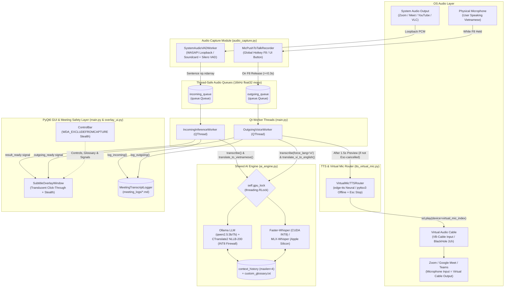
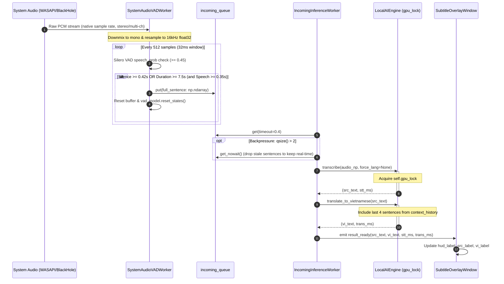
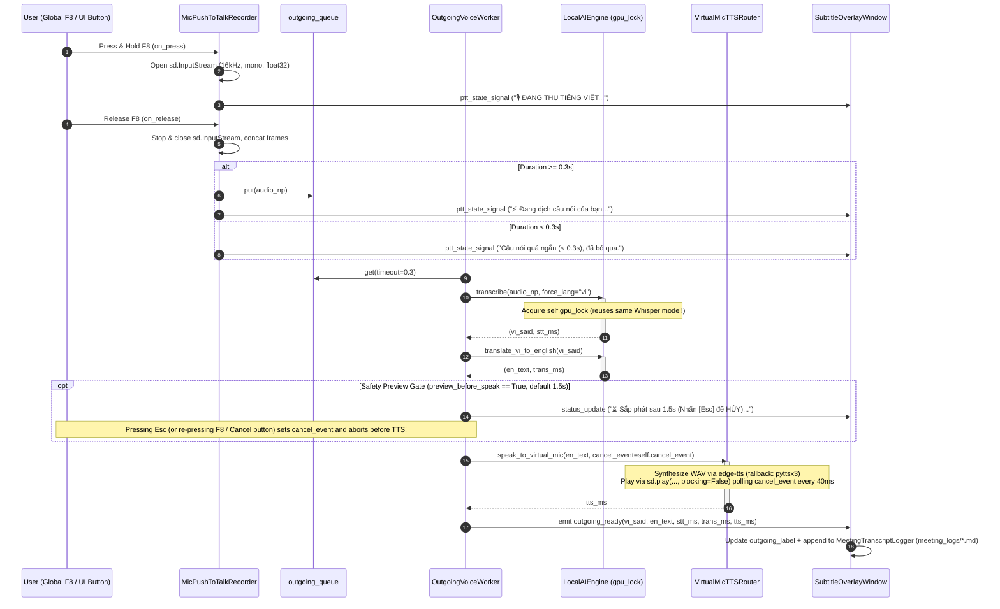

# ARCHITECTURE.md — System Architecture & Data Flow Specification

This document provides a deep-dive technical reference into the **Local AI 2-Way Live Translator** architecture, concurrency model, audio routing topology, and component interactions.

---

## 1. High-Level Component Architecture

---

## 2. Detailed Sequence Flows

### 2.1. Chiều Nghe (Incoming Audio $\rightarrow$ Vietnamese Subtitles)

### 2.2. Chiều Nói (Outgoing Push-to-Talk `F8` $\rightarrow$ English Virtual Mic)

---

## 3. Concurrency & Threading Model

The application runs **6 distinct execution threads**. Understanding their boundaries is critical for avoiding race conditions or Qt GUI freezes:

| # | Thread Name / Class | Base Type | Lifecycle | Communicates With | Synchronization Mechanism |
| :- | :--- | :--- | :--- | :--- | :--- |
| 1 | **Qt Main GUI Thread** | Event Loop (`QApplication`) | App start $\rightarrow$ exit | All UI widgets (`ControlBar`, `SubtitleOverlayWindow`), `MeetingTranscriptLogger` | Receives updates strictly via `pyqtSignal` |
| 2 | **`SystemAudioVADWorker`** | `threading.Thread(daemon=True)` | Started/Stopped via `toggle_capture()` | Pushes `np.ndarray` to `incoming_queue`; emits status via `hud_state_signal` | `queue.Queue`, `self.running` flag |
| 3 | **`IncomingInferenceWorker`** | `QThread` | Started/Stopped via `toggle_capture()` | Reads `incoming_queue`; calls `LocalAIEngine`; emits `result_ready` & `status_update` | `LocalAIEngine.gpu_lock`, `pyqtSignal` |
| 4 | **`OutgoingVoiceWorker`** | `QThread` | Runs continuously from launch until `closeEvent` | Reads `outgoing_queue`; runs `1.5s` safety preview; calls `LocalAIEngine` & `VirtualMicTTSRouter`; emits `outgoing_ready` | `LocalAIEngine.gpu_lock`, `self.cancel_event`, `pyqtSignal` |
| 5 | **`pynput.keyboard.Listener`** | `threading.Thread(daemon=True)` | Runs continuously from launch until `closeEvent` | Calls `ptt_recorder.start_recording()` / `stop_recording()` on `Key.f8`, and `outgoing_worker.cancel_current()` on `Key.esc` | `MicPushToTalkRecorder.is_recording`, `threading.Event` |
| 6 | **PortAudio Mic Callback** | C/PortAudio Thread (`sounddevice`) | Active only while `F8` is held | Appends mic chunks to `MicPushToTalkRecorder.frames` | Guarded by `self.is_recording` |

---

## 4. State & Queue Contracts

- **`incoming_queue` (`queue.Queue`):**
  - **Item Type:** `np.ndarray` (`dtype=np.float32`, 1D mono array at `16000 Hz`).
  - **Duration Range:** Typically `0.35s` to `7.5s` (`5,600` to `120,000` samples).
  - **Backpressure:** Drained down to the latest segment if `qsize() > 2`.
- **`outgoing_queue` (`queue.Queue`):**
  - **Item Type:** `np.ndarray` (`dtype=np.float32`, 1D mono array at `16000 Hz`).
  - **Duration Range:** `>= 0.3s` (`>= 4,800` samples), bounded by how long the user holds `F8`.
  - **Backpressure:** FIFO (every user utterance >= `0.3s` is processed in order).
- **`LocalAIEngine.context_history` (`collections.deque(maxlen=4)`):**
  - Stores tuples of `(source_text: str, vi_text: str)` for the last 4 incoming sentences.
  - Injected into the Ollama prompt (`_translate_ollama_to_vi`) so pronouns, domain terms, and conversational flow remain coherent across sentences.
  - Note: Outgoing utterances (`VI -> EN`) do **not** pollute `context_history`.

