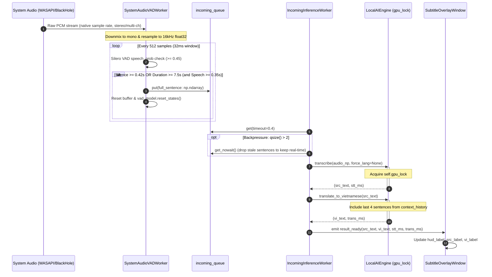
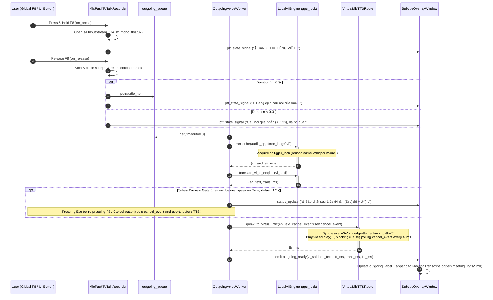

# ARCHITECTURE.md — System Architecture & Data Flow Specification

This document provides a deep-dive technical reference into the **Local AI 2-Way Live Translator** architecture, concurrency model, audio routing topology, and component interactions.

---

## 1. High-Level Component Architecture

```mermaid
flowchart TB
    subgraph OS_Audio["OS Audio Layer"]
        SysOut["System Audio Output<br/>(Zoom / Meet / YouTube / VLC)"]
        PhysMic["Physical Microphone<br/>(User Speaking Vietnamese)"]
        VirtCable["Virtual Audio Cable<br/>(VB-Cable Input / BlackHole 2ch)"]
        MeetMic["Zoom / Google Meet / Teams<br/>(Microphone Input = Virtual Cable Output)"]
        VirtCable --> MeetMic
    end

    subgraph Capture_Layer["Audio Capture & Browser Bridge (audio_capture.py & browser_bridge.py)"]
        VADWorker["SystemAudioVADWorker<br/>(WASAPI Loopback / Soundcard + Silero VAD)"]
        TabVAD["TabAudioVADWorker<br/>(BrowserBridgeServer WS 127.0.0.1:47863 + Silero VAD)"]
        PTTRec["MicPushToTalkRecorder<br/>(Global Hotkey F8 / UI Button)"]
    end

    subgraph Chrome_Ext["Chrome Extension MV3 (chrome_extension/*)"]
        YTHook["yt_caption_hook.js (MAIN World)<br/>(/api/timedtext json3/srv3/vtt + CC Flash-Fetch)"]
        TabCap["chrome.tabCapture + Offscreen AudioWorklet<br/>(40ms Int16 PCM + Speaker Passthrough / Standby)"]
        ShadowDOM["Content Script Shadow DOM Overlay<br/>(0ms currentTime Sync / SubtitlePacer + Summary Card)"]
        NativeHost["Native Messaging Host<br/>(native_host/launcher.py)"]
    end

    subgraph Queues["Thread-Safe Audio Queues (16kHz float32 mono)"]
        InQ[("incoming_queue / bridge_queue<br/>(queue.Queue)")]
        OutQ[("outgoing_queue<br/>(queue.Queue)")]
    end

    subgraph Workers["Qt Worker Threads (incoming_pipeline.py, youtube_caption.py, interpreter_summary.py & main.py)"]
        InWorker["IncomingInferenceWorker (QThread)"]
        CapWorker["CaptionTranslationWorker (QThread)<br/>(+90s Sliding Batch + caption_cache/)"]
        SumWorker["SummaryWorker (QThread)<br/>(Interval / Pause / Manual / Cap)"]
        OutWorker["OutgoingVoiceWorker (QThread)"]
    end

    subgraph Shared_AI["Shared AI Engine (ai_engine.py)"]
        GPULock{"self.gpu_lock (CTranslate2) +<br/>self._llm_lock / _llm_preempt (Ollama)"}
        Whisper["Faster-Whisper (CUDA INT8) /<br/>MLX-Whisper (Apple Silicon)"]
        Translator["Ollama LLM (qwen2.5:3b/7b, OLLAMA_NUM_CTX=1024) +<br/>CTranslate2 NLLB-200 (INT8 Firewall)"]
        CtxHist[("context_history (maxlen=4)<br/>+ custom_glossary.txt")]
        GPULock --> Whisper
        GPULock --> Translator
        Translator <--> CtxHist
        Whisper <--> CtxHist
    end

    subgraph TTS_Layer["TTS & Virtual Mic Router (tts_virtual_mic.py)"]
        TTSRouter["VirtualMicTTSRouter<br/>(edge-tts Neural / pyttsx3 Offline + Esc Stop)"]
    end

    subgraph UI_Layer["PyQt6 GUI & Meeting Safety Layer (main.py & overlay_ui.py)"]
        CtrlBar["ControlBar<br/>(WDA_EXCLUDEFROMCAPTURE Stealth)"]
        Overlay["SubtitleOverlayWindow + SummaryPanelWindow<br/>(Translucent Click-Through + Stealth)"]
        MeetLog[("MeetingTranscriptLogger<br/>(meeting_logs/meeting_*.md & video_*.md)")]
    end

    SysOut -->|"Loopback PCM"| VADWorker
    VADWorker -->|"Sentence np.ndarray"| InQ
    YTHook -->|"WS JSON captions_load (YouTube VOD/Shorts)"| CapWorker
    CapWorker -->|"translate_caption_batch() (urgent / +90s prefetch)"| GPULock
    CapWorker -->|"WS JSON {caption_track_ready, caption_cues}"| ShadowDOM
    CapWorker -->|"Watched cues only"| SumWorker
    CapWorker -->|"Watched cues only"| MeetLog
    TabCap -->|"WS Binary Int16 PCM (Audio Fallback)"| TabVAD
    NativeHost -.->|"Auto-start bridge_server.py"| TabVAD
    TabVAD -->|"Sentence np.ndarray"| InQ
    InQ --> InWorker
    InWorker -->|"transcribe() & translate_to_vietnamese()"| GPULock
    InWorker -->|"result_ready signal (Desktop)"| Overlay
    InWorker -->|"add_sentence(src, vi)"| SumWorker
    SumWorker -->|"generate_summary_json() (low-priority, preemptible)"| GPULock
    SumWorker -->|"summary_ready signal"| Overlay
    SumWorker -->|"WS JSON {summary, summary_status}"| ShadowDOM
    SumWorker -->|"log_summary()"| MeetLog
    InWorker -->|"WS JSON {source, result} (Chrome)"| ShadowDOM
    InWorker -->|"log_incoming()"| MeetLog

    PhysMic -->|"While F8 Held"| PTTRec
    PTTRec -->|"On F8 Release (>=0.3s)"| OutQ
    OutQ --> OutWorker
    OutWorker -->|"transcribe(force_lang='vi') & translate_vi_to_english()"| GPULock
    OutWorker -->|"After 1.5s Preview (if not Esc-cancelled)"| TTSRouter
    TTSRouter -->|"sd.play(device=virtual_mic_index)"| VirtCable
    OutWorker -->|"outgoing_ready signal"| Overlay
    OutWorker -->|"log_outgoing()"| MeetLog
    CtrlBar -.->|"Controls, Glossary & Signals"| Overlay
```



---

## 2. Detailed Sequence Flows

### 2.1. Chiều Nghe (Incoming Audio $\rightarrow$ Vietnamese Subtitles)



### 2.2. Chiều Nói (Outgoing Push-to-Talk `F8` $\rightarrow$ English Virtual Mic)



### 2.3. Chiều Nghe Tab Chrome (`Alt+Shift+T` $\rightarrow$ Local WebSocket Bridge $\rightarrow$ Shadow DOM `<video>` Overlay)

```mermaid
sequenceDiagram
    autonumber
    participant User as User (Alt+Shift+T / Popup)
    participant SW as Extension Service Worker
    participant NH as Native Host (launcher.py)
    participant Off as Offscreen AudioWorklet
    participant WS as BrowserBridgeServer (127.0.0.1:47863)
    participant TVAD as TabAudioVADWorker
    participant InW as IncomingInferenceWorker
    participant CS as Content Script (Shadow DOM + SubtitlePacer)

    User->>SW: Press Alt+Shift+T on video tab
    SW->>SW: chrome.tabCapture.getMediaStreamId(tabId) (immediate in gesture)
    alt GET /health unreachable
        SW->>NH: connectNative("com.local_translator.bridge") {cmd: "ensure_running"}
        NH->>WS: Spawn detached pythonw.exe bridge_server.py --idle-exit 900
        SW->>WS: Poll GET /health until ok: true + GET /token
    end
    SW->>Off: OFFSCREEN_START (streamId, wsUrl, token, lang, mode, glossary)
    Off->>Off: getUserMedia(streamId) -> source.connect(audioCtx.destination)
    Off->>WS: Connect ws://127.0.0.1:47863/ws?token=... & send JSON {"type": "hello"}
    WS-->>Off: JSON {"type": "state", "state": "ready"}
    loop Every 40ms audio frame
        Off->>WS: Binary ArrayBuffer (Int16 mono PCM at 48kHz)
        WS->>TVAD: push_pcm_bytes() -> _StreamingResampler(48k->16k) -> _process_audio_stream()
        opt Complete sentence detected by Silero VAD
            TVAD->>InW: bridge_queue.put(sentence_np)
            InW->>WS: source_ready(src_text, stt_ms)
            WS-->>Off: JSON {"type": "source", "src": src_text, "stt_ms": stt_ms}
            Off-->>CS: Forward STREAM_EVENT -> SubtitlePacer.onSource(src_text)
            InW->>WS: result_ready(src_text, vi_text, stt_ms, trans_ms) + log to video_*.md
            WS-->>Off: JSON {"type": "result", "src": src_text, "vi": vi_text, ...}
            Off-->>CS: Forward STREAM_EVENT -> SubtitlePacer.onResult(src_text, vi_text)
        end
    end
```

---

## 3. Concurrency & Threading Model

The application runs **up to 9 distinct execution threads** (7 in desktop mode + 2 when a Chrome Extension session is active). Understanding their boundaries is critical for avoiding race conditions or Qt GUI freezes:

| # | Thread Name / Class | Base Type | Lifecycle | Communicates With | Synchronization Mechanism |
| :- | :--- | :--- | :--- | :--- | :--- |
| 1 | **Qt Main Thread** | Event Loop (`QApplication` / `QCoreApplication`) | App start $\rightarrow$ exit | All UI widgets (`ControlBar`, `SubtitleOverlayWindow`, `SummaryPanelWindow`), `MeetingTranscriptLogger`, `BridgeSession` slots | Receives updates strictly via `pyqtSignal` |
| 2 | **`SystemAudioVADWorker`** | `threading.Thread(daemon=True)` | Started/Stopped via `toggle_capture()` | Pushes `np.ndarray` to `incoming_queue`; emits status via `hud_state_signal` | `queue.Queue`, `self.running` flag |
| 3 | **`IncomingInferenceWorker`** | `QThread` | Active per desktop capture or `BridgeSession` | Reads `incoming_queue` / `bridge_queue`; calls `LocalAIEngine`; emits `source_ready`, `result_ready` & `status_update` | `LocalAIEngine.gpu_lock`, `LocalAIEngine._llm_lock`, `pyqtSignal` |
| 4 | **`OutgoingVoiceWorker`** | `QThread` | Runs continuously from launch until `closeEvent` | Reads `outgoing_queue`; runs `1.5s` safety preview; calls `LocalAIEngine` & `VirtualMicTTSRouter`; emits `outgoing_ready` | `LocalAIEngine.gpu_lock`, `LocalAIEngine._llm_lock`, `self.cancel_event`, `pyqtSignal` |
| 5 | **`pynput.keyboard.Listener`** | `threading.Thread(daemon=True)` | Runs continuously from launch until `closeEvent` | Calls `ptt_recorder.start_recording()` / `stop_recording()` on `Key.f8`, and `outgoing_worker.cancel_current()` on `Key.esc` | `MicPushToTalkRecorder.is_recording`, `threading.Event` |
| 6 | **PortAudio Mic Callback** | C/PortAudio Thread (`sounddevice`) | Active only while `F8` is held | Appends mic chunks to `MicPushToTalkRecorder.frames` | Guarded by `self.is_recording` |
| 7 | **`BrowserBridge` (`BrowserBridgeServer`)** | `threading.Thread(daemon=True)` (`asyncio` loop) | App start $\rightarrow$ exit (`127.0.0.1:47863`) | Serves `/health`, `/token`, `/ws`; bridges WebSocket frames to `BridgeSession` & emits `session_changed_signal` / `config_updated_signal` | `asyncio.run_coroutine_threadsafe`, `pyqtSignal` |
| 8 | **`TabAudioVADWorker`** | `threading.Thread(daemon=True)` | Active while a Chrome tab streams in Audio Mode | Converts WebSocket `int16` PCM $\rightarrow$ `16kHz float32`, runs Silero VAD, pushes sentences to `BridgeSession.queue` (`bridge_queue`) | `queue.Queue(maxsize=256)`, `self.running` flag |
| 9 | **`CaptionTranslationWorker`** | `QThread` | Active while a YouTube video runs in Caption Mode (mutually exclusive with #8) | Parses `json3`/`srv3`/`vtt`, loads/saves `caption_cache/`, translates `+90s` ahead in 4-sentence batches (`urgent=True` at playhead, `urgent=False` prefetch); emits `track_initialized`, `cues_ready` | `self._lock`, `threading.Condition`, `LocalAIEngine._llm_lock`, `pyqtSignal` |
| 10 | **`SummaryWorker`** | `QThread` | Active per desktop capture or `BridgeSession` | Accumulates `(src, vi, ts)` sentences; evaluates trigger (`interval` / `pause` / `manual` / `cap`); calls `engine.generate_summary_json()`; emits `summary_ready` & `status_update`; writes telemetry CSV | `self._lock`, `LocalAIEngine._llm_lock`, `LocalAIEngine._llm_preempt`, `pyqtSignal` |

---

## 4. State & Queue Contracts

- **`incoming_queue` & `bridge_queue` (`queue.Queue`):**
  - **Item Type:** `np.ndarray` (`dtype=np.float32`, 1D mono array at `16000 Hz`).
  - **Duration Range:** Typically `0.22s` to `5.2s` (`3,520` to `83,200` samples).
  - **Backpressure:** Drained down to the latest segment if `qsize() > 2` inside `IncomingInferenceWorker.run()`.
- **WebSocket PCM Stream (`ws://127.0.0.1:47863/ws?token=<hex>`):**
  - **Security Contract:** Bound strictly to `127.0.0.1`; requires both a valid 32-byte hex `token` (`bridge_token.txt`) and an `Origin` header starting with `chrome-extension://`.
  - **Binary Frame Format:** Little-endian `Int16` mono PCM (`40ms` frames = `1920` samples = `3840` bytes at `48000 Hz`), resampled to `16000 Hz float32` by `TabAudioVADWorker`.
- **`outgoing_queue` (`queue.Queue`):**
  - **Item Type:** `np.ndarray` (`dtype=np.float32`, 1D mono array at `16000 Hz`).
  - **Duration Range:** `>= 0.3s` (`>= 4,800` samples), bounded by how long the user holds `F8`.
  - **Backpressure:** FIFO (every user utterance >= `0.3s` is processed in order).
- **`LocalAIEngine.context_history` (`collections.deque(maxlen=4)`):**
  - Stores tuples of `(source_text: str, vi_text: str)` for the last 4 incoming sentences.
  - Injected into the Ollama prompt (`_translate_ollama_to_vi`) so pronouns, domain terms, and conversational flow remain coherent across sentences.
  - Note: Outgoing utterances (`VI -> EN`) do **not** pollute `context_history`.
- **Dual-Lock & Preemption Contract (`self.gpu_lock` vs `self._llm_lock` + `self._llm_preempt`):**
  - `self.gpu_lock` guards CTranslate2 models (`faster-whisper` and `NLLB-200`) on CUDA/CPU.
  - `self._llm_lock` guards HTTP calls to Ollama (`127.0.0.1:11434`). All Ollama calls (probe, warmup, live translation, and summary) use the single constant `OLLAMA_NUM_CTX = 1024` so Ollama never reloads the model in VRAM.
  - Live subtitle translation (`_call_ollama_chat`) has strict priority over summary (`generate_summary_json`): before acquiring `_llm_lock`, `_call_ollama_chat` sets `_llm_preempt` and invokes `_abort_active_summary_stream()` to close the streaming summary HTTP socket immediately (`~15 ms`), allowing `SummaryWorker` to keep its pending sentences and retry 1.0s later.
- **`interpreter_settings.json` (`SummarySettings` Persistence Contract):**
  - Persists user-configured Tier-2 summary parameters across Desktop (`main.py`) and Chrome Bridge (`browser_bridge.py`):
    `{"mode": "interval", "interval_sec": 30.0, "pause_sec": 2.0, "min_new_sentences": 3, "max_wait_sec": 45.0, "max_pending_sentences": 10, "max_points_shown": 4}`.
  - Clamped on load/update (`interval_sec` in `[10, 90]`, `pause_sec` in `[1.0, 6.0]`, `min_new_sentences` in `[1, 8]`).

