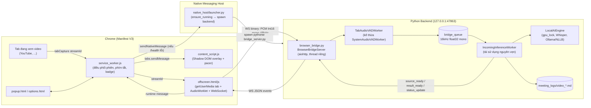

# CHROME_EXTENSION_SPEC.md — Đặc tả Triển khai Chrome Extension "Dịch Video Tại Chỗ"

> **Dành cho AI Agent / Developer thực hiện:** Đây là tài liệu đặc tả đầy đủ để xây dựng Chrome Extension tận dụng lại pipeline Chiều Nghe (STT + Dịch) sẵn có của dự án **Local AI 2-Way Live Translator**.
> **Trước khi code**, BẮT BUỘC đọc theo thứ tự: [`AGENTS.md`](../AGENTS.md) → [`PROGRESS.md`](../PROGRESS.md) → [`CLAUDE.md`](../CLAUDE.md) → [`ARCHITECTURE.md`](../ARCHITECTURE.md). Mọi bất biến kiến trúc trong `CLAUDE.md §4` vẫn phải được giữ nguyên.

---

## 0. TL;DR

- **Vấn đề của người dùng:** Hay xem video trên Chrome (YouTube, khóa học, podcast, hội thảo...). Mỗi lần muốn có phụ đề tiếng Việt phải mở app desktop (`setup_and_run.bat`), bấm `▶ Bật Dịch Chiều Nghe`, chỉnh cửa sổ overlay... → bất tiện.
- **Giải pháp:** Một Chrome Extension (Manifest V3) + một **Bridge Server cục bộ** (Python, chạy trong cùng tiến trình với `LocalAIEngine`):
  1. Người dùng bấm **phím tắt `Alt+Shift+T`** (hoặc icon extension) trên tab đang xem video.
  2. Extension tự đánh thức backend (qua **Native Messaging** nếu backend chưa chạy), thu **riêng âm thanh của tab đó** bằng `chrome.tabCapture`, stream PCM qua **WebSocket `127.0.0.1`** sang backend.
  3. Backend đưa PCM vào **chính pipeline VAD + Whisper + Ollama/NLLB hiện có** (không viết lại AI).
  4. Kết quả dịch đẩy ngược về extension → **phụ đề song ngữ vẽ đè trực tiếp lên thẻ `<video>`** (kể cả fullscreen).
  5. Bấm lại `Alt+Shift+T` để tắt. Backend tự thoát sau 15 phút rảnh để giải phóng VRAM.
- **100% local, không gửi âm thanh ra Internet.** Chỉ dùng chiều Nghe (Incoming). Chiều Nói (F8, Virtual Mic) **không** nằm trong phạm vi extension.

---

## 1. Phạm vi (Scope)

### 1.1. Trong phạm vi (MUST)
| # | Tính năng |
|:-|:-|
| F1 | Bật/tắt dịch trên tab hiện tại bằng phím tắt `Alt+Shift+T` và nút trong popup. |
| F2 | Thu âm thanh **chỉ của tab** (`chrome.tabCapture`) — không lẫn âm thanh hệ thống/ứng dụng khác. Tab vẫn phát tiếng bình thường cho người dùng nghe. |
| F3 | Tự khởi động backend nếu chưa chạy (Native Messaging launcher), hiển thị trạng thái nạp model trên overlay. |
| F4 | Phụ đề song ngữ overlay trên video: dòng lịch sử `⤴`, dòng gốc (nhỏ), dòng tiếng Việt (vàng, to). Hoạt động ở chế độ thường, theater, **fullscreen**. |
| F5 | Port bộ điều nhịp đọc (`_display_queue` / pacer / merge mảnh câu) từ `overlay_ui.py` sang JS để trải nghiệm đọc giống app desktop. |
| F6 | Popup: trạng thái, ngôn ngữ nguồn (`en`/`auto`/`ja`/`zh`/`ko`), chế độ dịch (`ollama`/`nllb_ct2`), chỉ hiện tiếng Việt, cỡ chữ, bật/tắt lưu transcript. |
| F7 | Trang Options: cổng backend, từ điển thuật ngữ (glossary), vị trí/cỡ chữ mặc định, kiểm tra kết nối. |
| F8 | Lưu transcript song ngữ ra `meeting_logs/video_YYYY-MM-DD_HH-MM-SS.md` (kèm tiêu đề trang + URL). |
| F9 | Chạy được ở 2 chế độ backend: **Integrated** (app desktop đang mở) và **Headless** (không mở cửa sổ Qt nào). |
| F10 | Xử lý trạng thái: video pause/seek, chuyển video SPA trên YouTube, đóng tab, mất kết nối backend, Ollama chết → fallback NLLB. |
| F11 | **YouTube Caption Mode (Hybrid Fast-Path):** Trên YouTube VOD/Shorts có phụ đề gốc hoặc phụ đề tự động ngoại ngữ (`/api/timedtext`), tự thu gói `json3`/`srv3`/`vtt` (kể cả khi nút CC của YouTube đang tắt: tự nháy nạp `~200ms` rồi khôi phục CC về trạng thái cũ, không chèn CSS ẩn CC của YouTube), dịch theo cụm 4 câu có ngữ cảnh trước + đón đầu (`+90s` sliding window + `caption_cache/`), hiển thị khớp `0 ms` theo `video.currentTime` (`0%` tải Whisper STT), và tự động rơi về Audio Mode (`tabCapture` → Whisper) khi video không có phụ đề hoặc là livestream. |

### 1.2. Ngoài phạm vi (WON'T, ở bản này)
- Chiều Nói (F8 → Virtual Mic), TTS.
- Dịch nhiều tab cùng lúc (GPU chỉ có 1 bộ model → **chỉ 1 phiên dịch tại một thời điểm**; bật tab mới sẽ tự tắt tab cũ).
- Tự động bật dịch khi vừa mở trang mà không có thao tác người dùng (**không khả thi**: `chrome.tabCapture` bắt buộc có user gesture — phím tắt hoặc click icon. Phím tắt chính là lời giải cho sự bất tiện).
- Làm chậm luồng video (delay video), tự ẩn phụ đề gốc của YouTube bằng CSS, hoặc hỗ trợ Firefox/Safari.
- Phát hành lên Chrome Web Store (chỉ dùng chế độ *Load unpacked* cá nhân).

---

## 2. Kiến trúc Tổng thể



### 2.1. Lý do các lựa chọn chính
| Quyết định | Lý do |
|:-|:-|
| `chrome.tabCapture` thay vì WASAPI Loopback | Chỉ lấy âm thanh của tab video → không bị thông báo Zalo/nhạc nền/Zoom lẫn vào. Âm thanh có sẵn dạng PCM sạch, không cần chọn thiết bị loa. |
| Tái sử dụng `SystemAudioVADWorker._process_audio_stream()` | Toàn bộ tinh chỉnh VAD/AGC/HPF/Smart Valley Split/rescue window (PROGRESS.md §2.3 mục 7–12) được giữ nguyên. **Không viết lại VAD trong JS.** |
| Tái sử dụng `IncomingInferenceWorker` | Giữ nguyên logic nối liên từ, lọc từ đệm, backpressure (`qsize() > 2`) — bất biến #4. |
| Gửi PCM ở sample rate gốc (48kHz) thay vì hạ tần trong JS | Dùng lại `_StreamingResampler` (torchaudio, chống răng cưa, sai số `< 1.2e-7`). Băng thông localhost ~96 KB/s là không đáng kể. |
| WebSocket nằm trong **offscreen document**, không nằm trong content script | Offscreen chạy dưới origin `chrome-extension://`, tránh CSP của trang, mixed-content và Private Network Access. Service worker MV3 có thể bị kill nên không giữ socket/audio ở đó. |
| `aiohttp` cho server | **Đã cài sẵn trong `venv`** (đã kiểm tra), hỗ trợ cả HTTP + WebSocket, không thêm dependency. |
| Native Messaging launcher | Giải quyết đúng nỗi đau "phải đi tìm bật app": extension tự khởi động backend. |

---

## 3. Cấu trúc File Cần Tạo / Sửa

```text
d:\AI\AI Translation\
├── browser_bridge.py            # [MỚI] BrowserBridgeServer + TabAudioVADWorker + BridgeSession
├── bridge_server.py             # [MỚI] Entry point Headless (QCoreApplication, không cửa sổ)
├── incoming_pipeline.py         # [MỚI - refactor] Di chuyển NGUYÊN VĂN IncomingInferenceWorker + MeetingTranscriptLogger từ main.py
├── main.py                      # [SỬA] import lại từ incoming_pipeline.py; khởi chạy BrowserBridgeServer chế độ Integrated
├── bridge_token.txt             # [TỰ SINH lúc chạy] token bí mật, thêm vào .gitignore
├── native_host/
│   ├── launcher.py              # [MỚI] Native Messaging host (stdin/stdout length-prefixed JSON)
│   ├── launcher.bat             # [MỚI] Wrapper gọi venv\Scripts\python.exe launcher.py
│   ├── com.local_translator.bridge.json.template  # [MỚI] manifest host (điền path + extension id)
│   └── install_native_host.ps1  # [MỚI] Ghi manifest + registry HKCU, tạo Scheduled Task fallback
├── start_bridge.bat             # [MỚI] Chạy tay backend headless (dự phòng)
├── chrome_extension/
│   ├── manifest.json
│   ├── service_worker.js
│   ├── offscreen.html
│   ├── offscreen.js
│   ├── pcm_worklet.js           # AudioWorkletProcessor: downmix mono + gom khung + Int16
│   ├── content_script.js
│   ├── overlay.css              # nạp vào Shadow DOM
│   ├── subtitle_pacer.js        # port logic điều nhịp từ overlay_ui.py (module thuần, test được)
│   ├── popup.html / popup.js / popup.css
│   ├── options.html / options.js
│   ├── shared/protocol.js       # hằng số message type, cổng mặc định
│   └── icons/ (16, 32, 48, 128 px — trạng thái thường)
├── tests/
│   ├── test_bridge_ws.py        # [MỚI] Gửi file WAV qua WS, kiểm tra nhận được event result
│   └── test_subtitle_pacer.html # [MỚI, tùy chọn] chạy pacer với dữ liệu giả trong trình duyệt
└── docs/CHROME_EXTENSION_SPEC.md  # (file này)
```

---

## 4. Backend Python — Đặc tả Chi tiết

### 4.1. Refactor nhỏ (bắt buộc, không đổi logic)
- Tạo `incoming_pipeline.py`, **di chuyển nguyên văn** `_PURE_FILLERS`, `_BARE_CONJUNCTIONS`, `_DANGLING_CONNECTORS`, `IncomingInferenceWorker`, `MeetingTranscriptLogger` (và hằng `MEETING_LOGS_DIR` nếu cần) từ `main.py`.
- `main.py` thay bằng `from incoming_pipeline import IncomingInferenceWorker, MeetingTranscriptLogger, ...`. Hành vi app desktop phải **giống hệt** trước khi refactor.
- Mục đích: `browser_bridge.py` / `bridge_server.py` **không được import `main.py`** (tránh import vòng và tránh kéo theo `pynput`/widgets).
- `MeetingTranscriptLogger.__init__` được phép thêm tham số tùy chọn `file_prefix: str = "meeting"` và `title: str | None = None` (mặc định giữ nguyên đầu ra cũ). Chế độ extension dùng `file_prefix="video"`, header ghi tiêu đề trang + URL.
- `logging.basicConfig(...)` hiện đang nằm ở `main.py`: tạo hàm `setup_logging()` dùng chung (có thể đặt trong `incoming_pipeline.py`) để headless cũng ghi `app_debug.log`. Dòng log của bridge dùng tiền tố `[Bridge]`.

### 4.2. `TabAudioVADWorker` (trong `browser_bridge.py`)
```python
class TabAudioVADWorker(SystemAudioVADWorker):
    """Nhận PCM từ WebSocket (Chrome tabCapture) thay vì WASAPI Loopback,
    rồi đưa qua NGUYÊN pipeline _process_audio_stream() sẵn có."""
    def __init__(self, sentence_queue, sample_rate: int, status_callback=None): ...
    def feed_pcm(self, pcm_int16_bytes: bytes) -> None: ...   # gọi từ asyncio thread, KHÔNG block
    def run(self): ...   # override: khởi tạo _StreamingSileroVAD trong thread, rồi _process_audio_stream(generator())
```
Yêu cầu:
- `pcm_queue = queue.Queue(maxsize=256)`; khi đầy → bỏ gói **cũ nhất** (giống `_wasapi_callback`).
- `generator()`: `get(timeout=0.12)`; nếu timeout → `yield resampler(silent_native_20ms)` (giống hệt nhánh WASAPI, để VAD xả câu cuối khi video pause/mất gói). Gom tối đa 6 blob mỗi lần.
- Chuyển đổi: `np.frombuffer(data, np.int16).astype(np.float32) / 32768.0` → `_StreamingResampler(orig_rate=sample_rate, target_rate=16000)`. Kiểm tra `_StreamingResampler` hoạt động đúng khi `sample_rate == 16000` (identity) và `44100`.
- **Hợp đồng mẫu âm thanh (AGENTS.md):** item đẩy vào queue luôn là `np.ndarray` 1D `float32` 16 kHz mono trong `[-1, 1]`. Không bao giờ đẩy `int16`.
- Không sửa `_process_audio_stream()` và các ngưỡng VAD. Nếu thật sự cần cấu hình khác cho tab audio, chỉ override thuộc tính instance trong `__init__` và ghi rõ lý do.

### 4.3. `BridgeSession`
Một phiên = một tab đang dịch. Tối đa **1 phiên active**.
- Thuộc tính: `session_id`, `tab_title`, `tab_url`, `sample_rate`, `ws`, `vad_worker: TabAudioVADWorker`, `infer_worker: IncomingInferenceWorker`, `queue: queue.Queue`, `transcript_logger`.
- `start()`: `engine.reset_context()`; tạo queue riêng (**không** dùng chung `ControlBar.incoming_queue`); tạo `IncomingInferenceWorker(queue, engine, is_vad_speaking_fn=lambda: vad_worker.is_capturing_speech)`; nối signal; `infer_worker.start()`; `vad_worker.start()`.
- Nối signal: dùng `Qt.ConnectionType.DirectConnection` tới hàm Python thuần chỉ làm `loop.call_soon_threadsafe(self._send_json, {...})`. **Không chạm widget nào** (bất biến #3). Chế độ Integrated nếu muốn mirror sang overlay desktop thì phải đi qua `pyqtSignal` của `ControlBar`.
- `stop(reason)`: `vad_worker.stop()`, `infer_worker.stop()`, `infer_worker.wait(3000)`, gửi `{"type":"stopped","reason":...}`.

### 4.4. `BrowserBridgeServer`
```python
class BrowserBridgeServer:
    def __init__(self, engine: LocalAIEngine, host="127.0.0.1", port=47863,
                 token: str = ..., mode: Literal["integrated","headless"] = "integrated",
                 on_session_started=None, on_session_stopped=None,
                 idle_exit_sec: float | None = None): ...
    def start(self) -> None   # chạy asyncio loop + aiohttp trong threading.Thread(daemon=True, name="BrowserBridge")
    def stop(self) -> None
```
- **Bind duy nhất `127.0.0.1`**. Không bao giờ `0.0.0.0`.
- Endpoints:
  - `GET /health` → `{"ok":true,"app":"local-live-translator","version":"1.0","mode":"integrated|headless","models_loaded":bool,"translation_mode":"ollama|nllb_ct2","source_lang":"en","device":"<profile.device_name>","session_active":bool}`. Không yêu cầu token (chỉ thông tin không nhạy cảm) nhưng vẫn kiểm Origin nếu có header.
  - `GET /ws?token=...` → WebSocket. Từ chối (`403`) nếu token sai hoặc `Origin` không bắt đầu bằng `chrome-extension://`.
- Token: nếu `bridge_token.txt` chưa có → sinh `secrets.token_urlsafe(24)` và lưu. Thêm `bridge_token.txt` vào `.gitignore`.
- Cổng bận (đã có backend khác chạy) → log cảnh báo, không crash app desktop.
- `idle_exit_sec` (chỉ headless, mặc định `900`): không có phiên nào trong N giây → gọi callback để `QCoreApplication.quit()` → giải phóng VRAM.
- Glossary: nhận từ extension → `engine.set_custom_glossary(text)`; ở Integrated thì cập nhật cả ô `glossary_input` qua signal, và ghi `custom_glossary.txt` như `ControlBar.on_glossary_changed`.

### 4.5. Chế độ Integrated (sửa `main.py`)
- Trong `ControlBar.__init__`: khởi tạo `BrowserBridgeServer(self.engine, mode="integrated", on_session_started=..., on_session_stopped=...)` và `start()`. Callbacks phải `emit` một `pyqtSignal` mới (ví dụ `bridge_event_signal = pyqtSignal(str, str)`), slot trên GUI thread xử lý.
- **Độc quyền nguồn Chiều Nghe:** khi phiên tab bắt đầu mà `self.audio_worker` (WASAPI) đang chạy → tự dừng Chiều Nghe desktop (gọi lại logic `toggle_capture()` qua slot), hiển thị `"🌐 Chrome đang dịch tab: <tiêu đề>. Đã tạm dừng Chiều Nghe loa hệ thống."`. Ngược lại, khi người dùng bấm `▶ Bật Dịch Chiều Nghe` trong lúc có phiên tab → dừng phiên tab (gửi `stopped` reason `desktop_takeover`). Lý do: dùng chung `context_history` và GPU.
- Thêm 1 label nhỏ trên `ControlBar`: `🌐 Chrome: Chưa kết nối | Đang dịch: <title>`.
- `closeEvent`: dừng bridge server.
- Chiều Nói F8 không bị ảnh hưởng.

### 4.6. Chế độ Headless (`bridge_server.py`)
```text
python bridge_server.py [--port 47863] [--idle-exit 900] [--no-idle-exit]
```
- `QCoreApplication(sys.argv)` (không tạo widget nào), `setup_logging()`, `detect_hardware_profile()`, `LocalAIEngine(profile)`, nạp `custom_glossary.txt`, `BrowserBridgeServer(mode="headless")`, `app.exec()`.
- Nếu cổng đã bị chiếm bởi backend hợp lệ (`/health` trả `app == local-live-translator`) → thoát ngay mã `0` (tránh nạp model 2 lần, tốn VRAM gấp đôi).
- **Nạp model sớm** ngay khi khởi động (trong thread nền, ví dụ gọi `engine.load_stt_model()` + `_ensure_nllb_loaded`) để lần bật đầu tiên không phải chờ — nhưng các lệnh nạp phải nằm ngoài main thread. `/health.models_loaded` phản ánh trạng thái.
- Chạy bằng `pythonw.exe` (không cửa sổ console). Ollama: tái sử dụng logic tự khởi động sẵn có của `LocalAIEngine` (`warmup_ollama` / `_start_or_restart_ollama`) — không viết lại.

### 4.7. Native Messaging Host (`native_host/`)
- Tên host: `com.local_translator.bridge`.
- Manifest (`com.local_translator.bridge.json`):
  ```json
  {
    "name": "com.local_translator.bridge",
    "description": "Local AI Live Translator launcher",
    "path": "D:\\AI\\AI Translation\\native_host\\launcher.bat",
    "type": "stdio",
    "allowed_origins": ["chrome-extension://<EXTENSION_ID>/"]
  }
  ```
- `install_native_host.ps1 -ExtensionId <id>`: điền template → ghi file manifest → tạo registry `HKCU\Software\Google\Chrome\NativeMessagingHosts\com.local_translator.bridge` (Default = đường dẫn manifest). Không cần quyền admin.
- **ID extension cố định:** thêm trường `"key"` (public key) vào `manifest.json` để ID không đổi khi load unpacked ở máy khác/thư mục khác; script cài đặt in ra ID. Ghi hướng dẫn tạo key trong README phần extension.
- Giao thức stdio: 4 byte độ dài (uint32 little-endian) + JSON UTF-8, cả hai chiều. Bắt buộc `msvcrt.setmode(..., os.O_BINARY)` cho stdin/stdout trên Windows.
- Lệnh hỗ trợ:
  - `{"cmd":"ensure_running"}` → nếu `GET /health` OK → trả `{"ok":true,"already_running":true,"port":47863,"token":"..."}`; nếu không → spawn backend headless rồi trả `{"ok":true,"spawned":true,"port":...,"token":...}` **ngay** (không chờ model nạp xong; extension tự poll `/health`).
  - `{"cmd":"get_token"}` → trả token (để extension không cần người dùng dán token thủ công).
- Spawn: `subprocess.Popen([venv\Scripts\pythonw.exe, bridge_server.py, "--idle-exit", "900"], cwd=APP_DIR, creationflags=DETACHED_PROCESS | CREATE_NEW_PROCESS_GROUP | CREATE_BREAKAWAY_FROM_JOB, close_fds=True)`.
  > [!WARNING]
  > Chrome có thể đặt native host trong Job Object, khiến tiến trình con bị kill khi host thoát. **Phải kiểm thử thực tế** rằng backend vẫn sống sau khi `launcher.py` trả lời và thoát. Nếu `CREATE_BREAKAWAY_FROM_JOB` bị từ chối (lỗi access denied), fallback: `install_native_host.ps1` tạo sẵn Scheduled Task `LocalTranslatorBridge` (chạy on-demand, không trigger) và launcher gọi `schtasks /Run /TN LocalTranslatorBridge` — tiến trình chạy hoàn toàn ngoài cây tiến trình của Chrome.
- `launcher.py` chỉ dùng thư viện chuẩn (không import torch) để phản hồi < 300 ms.
- Launcher ghi log riêng `native_host/launcher.log` (stdout dành riêng cho giao thức — **tuyệt đối không `print()` ra stdout**).

---

## 5. Giao thức WebSocket (Extension ⇄ Backend)

- URL: `ws://127.0.0.1:47863/ws?token=<token>`
- **Frame text** = JSON điều khiển/sự kiện. **Frame binary** = PCM `Int16 LE`, mono, ở `sample_rate` đã khai báo trong `start`. Khuyến nghị mỗi frame 40–100 ms âm thanh.

### 5.1. Client → Server
| `type` | Trường | Ý nghĩa |
|:-|:-|:-|
| `hello` | `client:"chrome-ext"`, `version`, tuỳ chọn `summary_mode`, `summary_interval_sec`, `summary_pause_sec`, `summary_min_new_sentences` | Bắt tay và đồng bộ cấu hình tóm tắt. Server trả `hello_ack`. |
| `start` | `session_id`, `sample_rate` (vd `48000`), `tab_title`, `tab_url`, `source_lang` (`en`/`auto`/`ja`/`zh`/`ko`), `translation_mode` (`ollama`/`nllb_ct2`), `save_transcript` (bool), `prefer_caption` (bool), `summary_mode` (`off`/`interval`/`pause`), `summary_interval_sec`, `summary_pause_sec`, `summary_min_new_sentences` | Mở phiên (`max_msg_size = 8 MB`). Nếu `prefer_caption: true` (trên YouTube), phiên khởi động ở chế độ chờ `captions_load` tối đa `2.4s` trước khi bật VAD/Whisper. |
| *(binary)* | PCM | Chỉ xử lý khi phiên đang ở chế độ `audio` (tạm dừng gửi từ `offscreen.js` khi ở Caption Mode để tiết kiệm CPU/GPU). |
| `captions_load` | `video_id`, `lang`, `kind`, `is_asr`, `fmt`, `raw`, `playhead_ms`, `playback_rate`, `tab_title`, `tab_url` | Gửi gói phụ đề `/api/timedtext` nguyên bản từ YouTube để kích hoạt `CaptionTranslationWorker` (`+90s` sliding batch). |
| `caption_unavailable` | `video_id`, `tab_title`, `tab_url` | Báo video không có phụ đề ngoại ngữ / là livestream → kích hoạt ngay `TabAudioVADWorker` + `IncomingInferenceWorker`. |
| `caption_seek` / `caption_progress` | `video_id`, `playhead_ms`, `playback_rate`, `paused` | Đồng bộ vị trí xem hiện tại (mỗi `1.5s` hoặc ngay khi tua `seeked`) để ưu tiên dịch quanh playhead và ghi biên bản / `SummaryWorker` đúng câu đã xem. |
| `config` | bất kỳ tập con: `source_lang`, `translation_mode`, `glossary`, `save_transcript`, `summary_mode`, `summary_interval_sec`, `summary_pause_sec`, `summary_min_new_sentences` | Cập nhật nóng. Đổi `translation_mode` hoặc `glossary` sẽ tự động dịch lại các câu phụ đề phía trước playhead (`invalidate_future_translations()`). |
| `summary_now` | *(không cần trường phụ)* | Kích hoạt `SummaryWorker.request_now()` để tổng hợp ý chính ngay lập tức. |
| `stop` | `session_id` | Đóng phiên. |
| `ping` | `t` | Server trả `pong` cùng `t`. Gửi mỗi 10 s. |

### 5.2. Server → Client
| `type` | Trường | Nguồn |
|:-|:-|:-|
| `hello_ack` | `mode`, `models_loaded`, `translation_mode`, `source_lang`, `device`, `summary_settings` (`{mode, interval_sec, pause_sec, min_new_sentences, ...}`) | |
| `status` | `message` (tiếng Việt, đúng chuỗi từ worker), `level` (`loading`/`ready`/`info`/`warn`/`error`) | `IncomingInferenceWorker.status_update`, `CaptionTranslationWorker.status_update`, status callback của VAD. |
| `source` | `text` | `source_ready` (Audio Mode: hiện câu gốc sớm ~0.6 s) |
| `result` | `src`, `vi`, `stt_ms`, `trans_ms`, `engine` (`Ollama`/`NLLB`) | `result_ready` (Audio Mode) |
| `caption_track_ready` | `video_id`, `lang`, `is_asr`, `total_cues`, `cached_hits`, `cues` (`[{cue_id, start_ms, end_ms, src, vi, engine, trans_ms}]`) | `CaptionTranslationWorker.track_initialized` (khung thời gian toàn bộ câu + các câu trúng cache từ `caption_cache/`) |
| `caption_cues` | `video_id`, `cues` (`[{cue_id, start_ms, end_ms, src, vi, engine, trans_ms}]`) | `CaptionTranslationWorker.cues_ready` (từng lô bản dịch mới hoàn thành quanh playhead) |
| `caption_fallback` | `video_id`, `reason` (`already_vi`/`empty_cues`/`grace_timeout`) | `BridgeSession` báo cho `offscreen.js` & `content_script.js` mở lại luồng PCM Audio Mode |
| `summary` | `topic`, `points` (mảng chuỗi, mới nhất ở đầu), `new_count`, `question`, `trigger` (`interval`/`pause`/`manual`/`cap`), `mode`, `updated_ts`, `latency_ms`, `sentences_merged` | `SummaryWorker.summary_ready` |
| `summary_status` | `message` (tiếng Việt, vd `"⏳ Đang tổng hợp ý..."` hoặc `"🧭 Ý chính cần Ollama — đang tạm dừng"`) | `SummaryWorker.status_update` |
| `mode` | `translation_mode` | `mode_synced` |
| `stopped` | `session_id`, `reason` (`client`/`replaced`/`desktop_takeover`/`error`/`shutdown`) | |
| `error` | `code`, `message` | |
| `pong` | `t` | |

---

## 6. Chrome Extension — Đặc tả Chi tiết

### 6.1. `manifest.json` (MV3)
```json
{
  "manifest_version": 3,
  "name": "Local AI Live Translator — Phụ đề Video",
  "version": "1.0.0",
  "description": "Dịch phụ đề tiếng Việt thời gian thực cho video trên tab, chạy 100% trên máy (Whisper + Ollama/NLLB).",
  "permissions": ["tabCapture", "offscreen", "storage", "activeTab", "scripting", "nativeMessaging", "tabs"],
  "host_permissions": ["http://127.0.0.1/*", "<all_urls>"],
  "background": { "service_worker": "service_worker.js", "type": "module" },
  "action": { "default_popup": "popup.html", "default_icon": { "16": "icons/16.png", "32": "icons/32.png" } },
  "options_page": "options.html",
  "commands": {
    "toggle-translate": { "suggested_key": { "default": "Alt+Shift+T" }, "description": "Bật/Tắt dịch video trên tab này" },
    "toggle-source-line": { "suggested_key": { "default": "Alt+Shift+S" }, "description": "Ẩn/Hiện dòng phụ đề gốc" },
    "toggle-overlay": { "suggested_key": { "default": "Alt+Shift+H" }, "description": "Ẩn/Hiện khung phụ đề (vẫn dịch ngầm)" }
  },
  "content_scripts": [{ "matches": ["<all_urls>"], "js": ["content_script.js"], "run_at": "document_idle", "all_frames": false }],
  "web_accessible_resources": [{ "resources": ["overlay.css", "subtitle_pacer.js"], "matches": ["<all_urls>"] }],
  "key": "<PUBLIC_KEY_ĐỂ_CỐ_ĐỊNH_ID>",
  "minimum_chrome_version": "116"
}
```
> Có thể chuyển sang inject theo yêu cầu (`chrome.scripting.executeScript` + `activeTab`) để giảm quyền; nhưng khi đó phải tự inject lại sau mỗi lần điều hướng trang. Với extension cá nhân, `content_scripts` tĩnh đơn giản và ổn định hơn. Content script phải **không làm gì** (không tạo DOM) cho tới khi nhận lệnh `overlay:show`.

### 6.2. Luồng bật dịch (Sequence)
```mermaid
sequenceDiagram
    autonumber
    actor U as Người dùng
    participant SW as service_worker
    participant OFF as offscreen
    participant NMH as native launcher
    participant BE as Backend 127.0.0.1:47863
    participant CS as content_script

    U->>SW: Alt+Shift+T (commands.onCommand) / nút popup
    SW->>SW: Nếu tab này đang dịch → luồng TẮT
    SW->>SW: streamId = tabCapture.getMediaStreamId({targetTabId}) (gọi NGAY, streamId hết hạn sau vài giây)
    SW->>OFF: tạo offscreen (reason USER_MEDIA) nếu chưa có; gửi {cmd:"capture:start", streamId, tabId, settings}
    OFF->>OFF: getUserMedia({audio:{mandatory:{chromeMediaSource:"tab", chromeMediaSourceId}}})
    OFF->>OFF: Nối source → AudioContext.destination (GIỮ TIẾNG cho người nghe) + → AudioWorklet
    SW->>CS: overlay:show + status "⏳ Đang kết nối máy dịch..."
    SW->>BE: fetch /health (timeout 800ms)
    alt Backend chưa chạy
        SW->>NMH: sendNativeMessage {cmd:"ensure_running"}
        NMH->>BE: spawn pythonw bridge_server.py
        NMH-->>SW: {ok, port, token}
        loop poll /health mỗi 1s, tối đa 90s
            SW->>BE: GET /health
        end
    end
    OFF->>BE: WS connect + hello + start(sample_rate, tab_title, ...)
    BE-->>OFF: status "⏳ Đang tải/nạp model STT..." ... "✅ Sẵn sàng"
    OFF->>BE: binary PCM liên tục
    BE-->>OFF: source / result
    OFF->>SW: runtime.sendMessage {evt, tabId}
    SW->>CS: tabs.sendMessage(tabId, evt)
    CS->>CS: subtitle_pacer → vẽ phụ đề
```

### 6.3. `service_worker.js`
- Trạng thái phiên lưu trong `chrome.storage.session` (SW có thể bị kill bất kỳ lúc nào): `{ activeTabId, sessionId, startedAt, backendState }`.
- Xử lý: `commands.onCommand`, message từ popup (`session:toggle`, `session:status`, `config:update`), message từ offscreen (relay sự kiện sang `tabs.sendMessage(activeTabId, ...)`), `tabs.onRemoved` (tab đang dịch bị đóng → stop), `tabs.onUpdated` với `status === "complete"` trên tab đang dịch (điều hướng trang mới → gửi lại `overlay:show` + trạng thái hiện tại; tabCapture vẫn tiếp tục trên cùng tab).
- Bật trên tab B khi tab A đang dịch → dừng A rồi mới bắt đầu B (chỉ 1 offscreen document & 1 phiên).
- Badge icon: `""` khi tắt; `"…"` nền xám khi đang khởi động/nạp model; `"VI"` nền xanh lá khi đang dịch; `"!"` nền đỏ khi lỗi. Tooltip (`action.setTitle`) ghi trạng thái tiếng Việt.
- Lỗi native host chưa cài (`chrome.runtime.lastError` "Specified native messaging host not found") → hiển thị trên overlay: `"❌ Chưa chạy được máy dịch. Hãy chạy start_bridge.bat hoặc cài Native Host (xem README)."`.

### 6.4. `offscreen.js` + `pcm_worklet.js`
- `AudioContext({ latencyHint: "interactive" })` — dùng `ctx.sampleRate` thực tế (thường 48000) khai báo trong `start`.
- **BẮT BUỘC** `source.connect(ctx.destination)`: `tabCapture` mặc định tắt tiếng tab; không nối lại thì người dùng sẽ mất tiếng video.
- `pcm_worklet.js`: downmix về mono (trung bình kênh), gom ~40 ms (`1920` mẫu @48k), clamp `[-1,1]` → `Int16Array`, `port.postMessage(buffer, [buffer])`.
- WebSocket: tự reconnect với backoff (0.5 s → 1 → 2 → 4, tối đa 5 s) khi backend đang khởi động/khởi động lại; trong lúc chưa kết nối **bỏ PCM** (không buffer dồn, để giữ thời gian thực). Khi reconnect gửi lại `hello` + `start` cùng `session_id`.
- Nếu `ws.bufferedAmount > 512 KB` → bỏ frame (backpressure phía client).
- Theo dõi `track.onended` (tab đóng/điều hướng chặn capture) → báo SW stop.
- `capture:stop` → gửi `stop`, đóng WS, dừng track, `ctx.close()`. SW đóng offscreen document sau khi stop.

### 6.5. `content_script.js` + `overlay.css` + `subtitle_pacer.js`
**Overlay DOM**
- Một host `<div id="lat-overlay-host">` + `attachShadow({mode:"closed"})` để CSS trang không ảnh hưởng và ngược lại. `z-index: 2147483647`, `pointer-events: none` trừ tay nắm kéo.
- Các dòng (từ trên xuống): `hud` (nhỏ, xám, có thể ẩn — hiện trạng thái/latency), `prev` (`⤴ ...`, mờ ~60%), `src` (trắng, ~0.6× cỡ chữ VI), `vi` (vàng `#FFD54A`, đậm, có viền/đổ bóng chữ), nền đen trong suốt ~55%, bo góc. Tự xuống dòng, giới hạn chiều rộng ~80% video.

**Định vị theo video**
- Chọn `<video>` mục tiêu: video đang phát (`!paused`) có diện tích hiển thị lớn nhất; quét lại khi DOM thay đổi (`MutationObserver`, throttle 1 s) và khi `play` event.
- Đặt overlay theo `getBoundingClientRect()` của video: căn giữa ngang, đáy cách đáy video 12% (tránh thanh điều khiển). Cập nhật bằng `ResizeObserver` + `scroll`/`resize` (throttle qua `requestAnimationFrame`).
- **Fullscreen:** nghe `fullscreenchange`; nếu `document.fullscreenElement` tồn tại → **di chuyển host vào bên trong `document.fullscreenElement`** (nếu không, overlay sẽ bị che hoàn toàn). Thoát fullscreen → trả host về `document.documentElement`.
- Không tìm thấy video (podcast, trang audio) → overlay cố định đáy giữa viewport.
- Người dùng có thể kéo overlay (giữ tay nắm nhỏ ở cạnh trái); lưu offset theo `location.hostname` trong `chrome.storage.local`.
- YouTube SPA: nghe `yt-navigate-finish` → `pacer.reset()` và tìm lại video.
- (Tùy chọn) Video pause > 5 s → làm mờ overlay; play lại → hiện bình thường.

**`subtitle_pacer.js` — port từ `overlay_ui.py`** (module thuần, không chạm DOM; phát callback `onRender({prev, src, vi})`):
- Port **chính xác** các hàm & hằng số: `_format_prev_line` (135 / 128 / 25 ký tự), `_merge_text_cleanly`, `_is_syntactic_continuation`, `_should_merge_with_current` (giới hạn 22 từ; `elapsed < 4.2`; `new_words <= 4 && elapsed < 2.6 && tổng <= 18`; `cur_words <= 4 && new_words <= 9 && elapsed < 2.0`), `_calculate_min_dwell_sec` (`q>=2 → 0.95`; `min(3.1, max(1.45, 0.95 + words*0.13))`; `q==1 → min(dwell, 2.15)`), `_roll_and_render`, `_on_pacer_tick` (ghép mảnh đuôi `<= 3` từ hoặc nối tiếp ngữ pháp, tổng `<= 22` từ; hẹn giờ `max(120ms, dwell)`), `update_incoming_subtitle` (4 nhánh: hiển thị ngay / merge tại chỗ cộng `0.35 + words*0.12` s / xếp hàng với chống trễ khi `queue > 2` / cuộn ngay), `show_incoming_source`, `reset_subtitles`.
- Dùng `performance.now()/1000` thay `time.monotonic()`, `setTimeout` thay `QTimer`. Lưu ý regex Python → JS (`str.isupper()` → so sánh `c === c.toUpperCase() && c !== c.toLowerCase()`).
- Chế độ "Chỉ hiện Tiếng Việt" = ẩn dòng `src` (giống `set_show_source_subtitle`).

### 6.6. Popup (`popup.html`) — toàn bộ nhãn tiếng Việt
- Dòng trạng thái: `🟢 Đang dịch: <tiêu đề tab>` / `⚪ Đang tắt` / `⏳ Đang nạp model...` / `🔴 Lỗi: ...` + thiết bị & chế độ dịch (từ `/health`).
- Nút lớn: `▶ Bật dịch tab này` / `⏹ Tắt dịch` (hiển thị phím tắt `Alt+Shift+T`).
- Chọn `Ngôn ngữ nguồn`: `en (Tiếng Anh)`, `auto (Tự nhận diện)`, `ja (Tiếng Nhật)`, `zh (Tiếng Trung)`, `ko (Tiếng Hàn)` — mặc định `en` (giống desktop).
- Chọn `Chế độ dịch`: `Ollama LLM (chuẩn ngữ cảnh)` / `NLLB-200 INT8 (siêu nhẹ)`; đồng bộ lại khi nhận event `mode` (backend có thể tự fallback).
- Checkbox: `👁️ Chỉ hiện Tiếng Việt`, `📝 Lưu transcript`, `📊 Hiện thông số trễ (HUD)`.
- Thanh trượt cỡ chữ (16–40 px, mặc định 26).
- Link `⚙️ Tùy chọn nâng cao` → options page.
- Mọi thay đổi lưu `chrome.storage.sync` và gửi `config:update` nóng nếu đang có phiên.

### 6.7. Options (`options.html`)
- Cổng backend (mặc định `47863`), nút `🔌 Kiểm tra kết nối` (gọi `/health`, hiện kết quả).
- Token: tự lấy qua native host `get_token`; ô nhập tay dự phòng nếu không cài native host (đọc từ `bridge_token.txt`).
- `📚 Từ điển thuật ngữ` (textarea, cú pháp giống `custom_glossary.txt`, VD `Kubernetes, SLA, P&L -> Báo cáo lãi lỗ`) → gửi `config.glossary`.
- Mặc định vị trí overlay (đáy video / đỉnh video), độ mờ nền, nút `↺ Đặt lại vị trí đã kéo trên mọi trang`.
- Hướng dẫn ngắn cài Native Host + link `chrome://extensions/shortcuts` để đổi phím tắt.

---

## 7. Bảo mật & Quyền riêng tư
1. Server chỉ bind `127.0.0.1`; không mở firewall; không CORS `*`.
2. WebSocket bắt buộc token + `Origin: chrome-extension://...` (nếu biết ID thì so khớp chính xác ID).
3. Native host chỉ cho phép đúng `allowed_origins` của extension ID cố định.
4. Không log nội dung PCM; transcript chỉ ghi khi `save_transcript = true`.
5. `bridge_token.txt`, `native_host/*.json` (đã điền đường dẫn), `native_host/launcher.log` thêm vào `.gitignore`.
6. Không có bất kỳ request nào ra Internet từ extension.

---

## 8. Bất biến Phải Giữ (đối chiếu `CLAUDE.md §4` & `AGENTS.md`)
| Bất biến | Áp dụng cho extension |
|:-|:-|
| #1 `gpu_lock` + 1 bộ model | Bridge dùng **chung instance `LocalAIEngine`** của ControlBar (Integrated) hoặc 1 instance duy nhất (Headless). Headless phải tự thoát nếu phát hiện backend khác đã chạy. Không tạo model thứ hai. |
| #2 Pascal `int8` | Không đụng `hardware_profile.py`. |
| #3 Qt cross-thread | Bridge thread/asyncio **không bao giờ** gọi `setText`/widget. Mọi tương tác UI desktop qua `pyqtSignal`. |
| #4 Backpressure `qsize() > 2` | Giữ nguyên trong `IncomingInferenceWorker`; bridge dùng queue riêng nhưng cùng class worker. |
| #5 Cách ly âm thanh | Nguồn tab audio độc lập; Chiều Nghe WASAPI và phiên tab **không chạy song song** (độc quyền nguồn, §4.5). |
| Sample Rate Contract | Queue chỉ nhận `float32` 16 kHz mono. |
| Không block GUI thread | aiohttp chạy thread riêng; nạp model trong worker thread. |
| Graceful degradation | Ollama lỗi → engine tự fallback NLLB (đã có); extension hiển thị event `mode`. Backend mất kết nối → overlay báo `⚠️ Mất kết nối máy dịch, đang thử lại...`, không crash. |
| Nhãn tiếng Việt | Toàn bộ UI extension & thông báo bằng tiếng Việt. |

---

## 9. Kế hoạch Triển khai theo Giai đoạn

| Giai đoạn | Nội dung | Tiêu chí nghiệm thu |
|:-|:-|:-|
| **P0 — Refactor** | Tách `incoming_pipeline.py`, `setup_logging()`. | App desktop chạy y hệt (bật Chiều Nghe trên 1 video YouTube, có phụ đề, có biên bản). `py_compile` sạch. |
| **P1 — Backend bridge** | `browser_bridge.py`, `bridge_server.py`, `tests/test_bridge_ws.py`. | Test script stream 1 file WAV 48kHz (≥ 60 s tiếng Anh, tốc độ thời gian thực) qua WS → nhận ≥ 1 event `source` và `result` có `vi` tiếng Việt; `/health` đúng; token sai → 403. |
| **P2 — Extension MVP** | manifest, SW, offscreen, worklet, content script overlay đơn giản (chưa pacer), popup tối thiểu. Backend chạy tay bằng `start_bridge.bat`. | Trên YouTube: `Alt+Shift+T` → vẫn nghe tiếng video, phụ đề tiếng Việt xuất hiện trong ≤ 3 s sau câu nói; tắt lại sạch sẽ (badge tắt, không còn offscreen). |
| **P3 — Native launcher** | `native_host/*`, `install_native_host.ps1`, idle-exit. | Đóng hết backend → `Alt+Shift+T` → backend tự khởi động, overlay hiện các bước `⏳` rồi phụ đề. Sau 15 phút không dùng, tiến trình `pythonw` tự thoát (VRAM giải phóng). Backend **sống sót** sau khi launcher thoát. |
| **P4 — UX hoàn chỉnh** | `subtitle_pacer.js`, fullscreen, kéo thả, options, glossary, transcript `video_*.md`, chế độ Integrated + độc quyền nguồn. | Toàn bộ checklist §10 đạt. |
| **P5 — Tài liệu** | Cập nhật docs (§11). | Docs phản ánh đúng kiến trúc mới. |

---

## 10. Checklist Kiểm thử Thủ công
- [ ] YouTube chế độ thường / theater / **fullscreen** (`F` key) — phụ đề luôn hiển thị đúng vị trí.
- [ ] Chuyển video khác trên YouTube (SPA) khi đang dịch — không cần bật lại, phụ đề reset.
- [ ] Pause 10 s rồi play — câu cuối trước pause được xả ra; không sinh câu ảo giác khi im lặng.
- [ ] Tua (seek) liên tục — không treo, phụ đề bắt kịp (backpressure hoạt động).
- [ ] Tắt tiếng tab bằng nút mute của trình phát → không có phụ đề mới (đúng hành vi).
- [ ] Đóng tab đang dịch → phiên tự dừng, badge tắt.
- [ ] Bật trên tab B khi tab A đang dịch → A tự tắt, B bật.
- [ ] App desktop đang mở + đang Chiều Nghe loa → bật extension → desktop tự tạm dừng Chiều Nghe, chỉ 1 dòng phụ đề (không dịch đôi).
- [ ] Tắt Ollama giữa chừng → tự chuyển NLLB, popup cập nhật chế độ, phụ đề không đứt.
- [ ] Backend bị kill giữa chừng → overlay báo mất kết nối; bật lại `start_bridge.bat` → tự kết nối lại.
- [ ] Native host chưa cài + backend không chạy → thông báo lỗi tiếng Việt rõ ràng.
- [ ] Trang khác: Vimeo, Udemy/Coursera, Spotify Web (không có `<video>` → overlay đáy viewport), Google Drive video, video nhúng trong iframe (MVP: overlay đáy viewport).
- [ ] Trang có DRM (Netflix): ghi nhận kết quả (âm thanh tab có thể bị chặn/im lặng) — chỉ cần không crash.
- [ ] Transcript `meeting_logs/video_*.md` có tiêu đề trang, URL, mốc giờ.
- [ ] App desktop: F8 chiều nói vẫn hoạt động bình thường khi phiên extension đang chạy.

**Lệnh kiểm tra bắt buộc sau mỗi lần sửa Python (AGENTS.md, bổ sung file mới):**
```powershell
.\venv\Scripts\python.exe -m py_compile hardware_profile.py audio_capture.py ai_engine.py tts_virtual_mic.py overlay_ui.py main.py incoming_pipeline.py browser_bridge.py bridge_server.py native_host\launcher.py
```

---

## 11. Cập nhật Tài liệu Khi Hoàn Thành
- `CLAUDE.md`: thêm các file mới vào bảng Repository Map; thêm lệnh chạy headless; cập nhật lệnh `py_compile`.
- `AGENTS.md`: cập nhật lệnh Verification; thêm pipeline thứ 3 "Chrome Tab → Bridge" vào sơ đồ §2.
- `ARCHITECTURE.md`: thêm component Bridge + Extension, sequence diagram §6.2, thread mới `BrowserBridge` (asyncio) và `TabAudioVADWorker` vào bảng Concurrency, hợp đồng `bridge_queue` + giao thức WS vào §4.
- `PROGRESS.md`: ghi mục hoàn thành mới + hướng dẫn sử dụng extension trong "Next Steps".
- `README.md`: mục "Dùng với Chrome": Load unpacked → chạy `install_native_host.ps1 -ExtensionId ...` → `Alt+Shift+T`.
- `docs/EXTENSION_GUIDE.md`: playbook thêm nguồn âm thanh mới (kế thừa `SystemAudioVADWorker` như `TabAudioVADWorker`).

---

## 12. Các Bẫy Kỹ thuật Đã Biết (Gotchas)
1. **`tabCapture` tắt tiếng tab** nếu không nối lại `ctx.destination` trong offscreen.
2. **`streamId` dùng một lần và hết hạn sau vài giây** → gọi `getMediaStreamId` trước, kiểm tra backend sau (song song).
3. `getMediaStreamId` cần extension được "invoke" trên tab (phím tắt `commands` hoặc click action đều hợp lệ). Không thể tự bật khi tải trang.
4. **Chỉ 1 offscreen document / extension** → khớp với ràng buộc 1 phiên.
5. **Service worker MV3 bị kill sau ~30 s rảnh** → không giữ state trong biến toàn cục; dùng `chrome.storage.session`. Sự kiện từ offscreen sẽ đánh thức SW.
6. **Fullscreen** che mọi phần tử không nằm trong `fullscreenElement`.
7. Native host Windows: stdout nhị phân, không `print`; Chrome có thể kill cây tiến trình con (xem cảnh báo §4.7).
8. Lần đầu nạp model ~15 s (đã cache ổ cứng) — overlay phải hiển thị chuỗi trạng thái `⏳` từ worker để người dùng không tưởng bị treo.
9. `IncomingInferenceWorker.run()` gọi `load_stt_model()`/`warmup_ollama()` mỗi lần start — đảm bảo các hàm này idempotent (đã nạp thì trả về ngay) để bật/tắt nhanh lần 2.
10. `engine.source_lang` / `translation_mode` là trạng thái dùng chung: ở chế độ Integrated, đổi từ extension sẽ ảnh hưởng combo trên ControlBar → đồng bộ lại combo qua signal (`blockSignals` như `_on_worker_mode_synced`).
11. Chuỗi status hiện có nhắc tới `[F8]` (vd `"✅ Sẵn sàng 2 Chiều ... & phím [F8]..."`) — ở chế độ headless, bridge có thể thay thế hiển thị thành `"✅ Sẵn sàng! Đang nghe âm thanh tab..."` phía extension; **không sửa chuỗi gốc trong worker** để không đổi hành vi desktop.

---

## 13. Quyết định Mở (nếu người dùng chưa xác nhận, dùng mặc định in đậm)
| Câu hỏi | Mặc định |
|:-|:-|
| Cổng backend | **`47863`** |
| Phím tắt | **`Alt+Shift+T`** (đổi được ở `chrome://extensions/shortcuts`) |
| Ngôn ngữ nguồn mặc định | **`en`** |
| Lưu transcript mặc định | **Bật** |
| Headless tự thoát khi rảnh | **15 phút** |
| Mirror phụ đề lên overlay desktop khi Integrated | **Tắt** |
| Tự động ẩn phụ đề CC gốc của YouTube khi đang dịch | **Không** (để người dùng tự quyết) |

