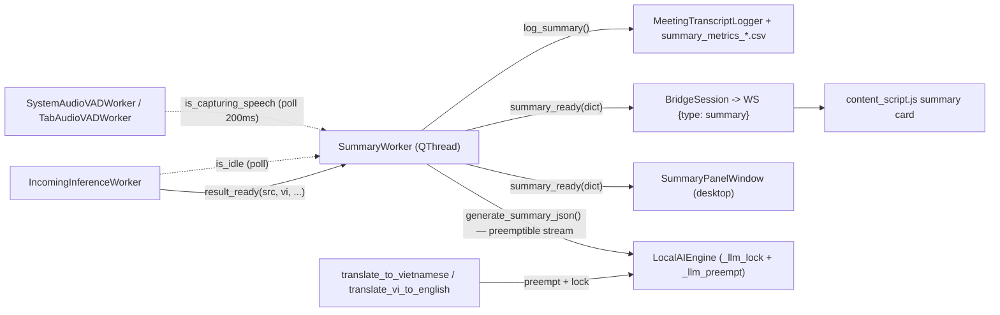

# INTERPRETER_SUMMARY_SPEC.md — Tầng 2 "Ý chính đang bàn" (Interpreter Summary Mode)

> **Dành cho AI Agent thực thi.** Đọc theo thứ tự trong [`AGENTS.md`](../AGENTS.md) (PROGRESS → CLAUDE → ARCHITECTURE) rồi mới đọc file này.
> Làm **tuần tự từng Phase**, mỗi Phase phải đạt tiêu chí nghiệm thu rồi mới sang Phase sau.
> Sau **mỗi** lần sửa code, chạy lệnh kiểm tra cú pháp bắt buộc trong `AGENTS.md` (thêm file mới `interpreter_summary.py` vào danh sách).

---

## 0. Mục tiêu & Phạm vi

### 0.1. Vấn đề
Phụ đề hiện tại dịch **từng câu** và trễ khoảng 2–4s. Người dùng vừa nghe tiếng Anh vừa đọc các mảnh câu tiếng Việt nên dễ mất mạch: không biết đoạn này đang nói về chủ đề gì và ý chính là gì.

### 0.2. Giải pháp
Thêm một luồng **tổng hợp ý chính** chạy song song với phụ đề, giống ghi chú của phiên dịch viên cabin:

```
📌 Chủ đề: Kế hoạch ra mắt sản phẩm Q4
• Đối tác muốn lùi deadline 2 tuần vì thiếu QA
• Đề xuất tăng ngân sách marketing 15%
❓ Đang hỏi bạn: có đồng ý lùi lịch không?
─ Cập nhật 8s trước · ⏸ nhịp nghỉ · 2.3s
```

Có **2 chế độ kích hoạt**. Người test được **đổi chế độ và chỉnh tham số khi app đang chạy** (không cần khởi động lại), để so sánh trên tình huống thực tế rồi mới chốt chế độ mặc định:

| Chế độ | Khóa `mode` | Kích hoạt khi | Tham số chỉnh được |
| :--- | :--- | :--- | :--- |
| Tắt | `off` | — | — |
| ⏱ Theo chu kỳ | `interval` | Mỗi `interval_sec` giây, **nếu** có ≥ `min_new_sentences` câu mới | `interval_sec` (15–90, mặc định 30) |
| ⏸ Theo nhịp nghỉ | `pause` | Người nói im ≥ `pause_sec` giây **và** có ≥ `min_new_sentences` câu mới; **hoặc** chốt an toàn: đã chờ ≥ `max_wait_sec` / tích ≥ `max_pending_sentences` câu (cho trường hợp độc thoại không nghỉ) | `pause_sec` (1.0–5.0, mặc định 2.0) |
| (cả hai chế độ) | — | Nút **"🔄 Tổng hợp ngay"** (kích hoạt thủ công, dùng khi test) | `min_new_sentences` (1–8, mặc định 3) |

### 0.3. Ngoài phạm vi (KHÔNG làm trong spec này)
- Tầng 1 "Dịch ý ngắn gọn", tầng 3 "Tóm tắt biên bản sau họp".
- Sửa cơ chế **bỏ đoạn cũ khi hàng đợi > 2** ở [`incoming_pipeline.py` L170-179](../incoming_pipeline.py). Ghi chú: cơ chế này làm tóm tắt thiếu câu. Ghi nhận trong telemetry (§6), không sửa.
- Nhận diện người nói (diarization), thiết lập tên người dùng cho mục "❓ Đang hỏi bạn".

### 0.4. Bất biến bắt buộc giữ nguyên
1. **Phụ đề trực tiếp luôn được ưu tiên.** Tóm tắt không được làm tăng độ trễ dịch câu quá **p95 +400ms** (đo ở §6).
2. Không gọi model/HTTP trên Qt GUI thread. Toàn bộ chạy trong `SummaryWorker` (QThread).
3. **Không làm Ollama nạp lại model.** Mọi request Ollama (dịch, warmup, probe, tóm tắt) phải dùng **cùng một giá trị `num_ctx`** (hằng `OLLAMA_NUM_CTX`). Ollama reload model khi `num_ctx` khác nhau.
4. Khi không có Ollama (chế độ `nllb_ct2` hoặc đang cooldown) thì tóm tắt **tự tạm dừng**, hiện trạng thái `"🧭 Ý chính cần Ollama — đang tạm dừng"`, không crash.
5. Mọi nhãn UI bằng tiếng Việt. Chống rò rỉ chữ Hán/Kirin bằng cách tái dùng `LocalAIEngine._contains_cjk()`.
6. Hợp đồng âm thanh 16kHz mono float32 **không bị đụng tới**: tính năng này chỉ đọc **text** đầu ra từ `result_ready`.

---

## 1. Kiến trúc tổng quan



**Ưu tiên LLM (cơ chế "nhường làn"):**
- `LocalAIEngine` có thêm `self._llm_lock = threading.Lock()` và `self._llm_preempt = threading.Event()`.
- **Lời gọi trực tiếp** (dịch chiều nghe/nói, đi qua `_call_ollama_chat`): `set()` preempt, gọi hàm hủy stream đang chạy (nếu có), `acquire()` lock (blocking), `clear()` preempt, gọi Ollama, release.
- **Lời gọi tóm tắt**: `acquire(blocking=False)`. Nếu không lấy được lock thì trả `None` (thử lại sau). Dùng `stream=True` và kiểm tra `_llm_preempt` sau mỗi chunk. Nếu bị preempt thì đóng response (Ollama tự hủy generation khi client ngắt kết nối), release lock, trả `None` và đánh dấu `preempted=True`.
- Request tóm tắt dùng **`requests.Session` riêng** (`self._http_summary`), không dùng chung `self._http`. `requests.Session` không thread-safe, và cần đóng được connection từ luồng khác.

---

## 2. Phase P0 — Nền tảng LLM trong `ai_engine.py` + Benchmark `num_ctx`

### 2.1. Việc cần làm
1. Thêm hằng module-level `OLLAMA_NUM_CTX = 1024` (giá trị tạm, chốt sau benchmark). Thay **mọi** literal `512` của Ollama bằng hằng này:
   - `_probe_ollama_inference()` (khoảng L346), default arg của `_call_ollama_chat()` (L807), bất kỳ chỗ nào trong `warmup_ollama()`/healer có gửi `num_ctx`.
   - Sửa comment L775 cho đúng nghĩa ("giữ nguyên `OLLAMA_NUM_CTX` thống nhất…").
   - Dùng lệnh `Select-String -Path *.py -Pattern "num_ctx"` để chắc chắn không sót.
2. Thêm `_llm_lock`, `_llm_preempt`, `_http_summary`, `_active_summary_resp` (giữ response đang stream, có lock nhỏ bảo vệ) vào `__init__`.
3. Bọc phần `self._http.post(...)` trong `_call_ollama_chat()` bằng cơ chế nhường làn ở §1. **Không đổi** chữ ký hàm và hành vi trả lỗi `"[Lỗi Ollama ...]"`. Nhánh retry Vulkan nằm trong cùng vùng lock.
4. Thêm method public:
   ```python
   def generate_summary_json(self, system_msg: str, user_msg: str,
                             max_wall_sec: float = 8.0) -> tuple[dict | None, dict]:
       """Trả (data | None, meta). meta = {ok, preempted, busy, error, prompt_ms, total_ms, raw}"""
   ```
   - Nếu `not self._can_use_ollama_now()` thì trả `(None, {ok: False, error: "no_ollama"})`.
   - Payload: `model=self.ollama_model`, `stream=True`, `format="json"`, `keep_alive="30m"`, `options={temperature: 0.2, top_p: 0.9, top_k: 30, repeat_penalty: 1.1, num_predict: 220, num_ctx: OLLAMA_NUM_CTX}`.
   - Đọc `resp.iter_lines()`, cộng dồn `message.content`. `prompt_ms` là thời điểm nhận chunk đầu. Kiểm tra preempt và `max_wall_sec` sau mỗi chunk.
   - Parse JSON bằng `json.loads`. Nếu lỗi, thử cắt từ `{` đầu tiên tới `}` cuối cùng rồi parse lại. Nếu vẫn lỗi thì `ok=False, error="bad_json"`.
   - **Không** gọi `_handle_ollama_failure()` khi lỗi tóm tắt. Lỗi tóm tắt không được đẩy app sang cooldown NLLB.
   - `finally`: đóng response, xóa `_active_summary_resp`, release lock.
5. Tạo script benchmark `tests/bench_ollama_ctx.py` (chạy tay, cần Ollama đang chạy):
   - Với mỗi `num_ctx ∈ {512, 1024, 2048}`: warmup một lần, rồi dịch 20 câu tiếng Anh mẫu (hard-code trong script), ghi lại p50/p95 `trans_ms` và VRAM (`nvidia-smi --query-gpu=memory.used --format=csv,noheader` nếu có).
   - Với 1024 và 2048: chạy `generate_summary_json` với 8 câu mẫu, ghi `prompt_ms`, `total_ms`.
   - Test preempt: chạy tóm tắt trong một thread, sau 300ms gọi dịch một câu ở thread chính, đo độ trễ dịch tăng thêm so với baseline.
   - In bảng Markdown ra stdout.

### 2.2. Tiêu chí nghiệm thu P0
- `py_compile` sạch. App desktop và Chrome vẫn dịch bình thường (chưa có UI mới).
- Có bảng benchmark. **Chọn `OLLAMA_NUM_CTX` nhỏ nhất** thỏa mãn: p95 dịch tăng ≤ 15% so với 512 **và** prompt tóm tắt (§3.3) vừa ngân sách. Ghi kết quả vào `PROGRESS.md`.
- Test preempt: độ trễ dịch tăng thêm p95 ≤ 400ms. Nếu vượt, ghi rõ nguyên nhân (thường là prompt eval không ngắt được) và báo lại trước khi sang P1.

---

## 3. Phase P1 — Lõi `interpreter_summary.py` + Unit test

### 3.1. File mới `interpreter_summary.py`
```python
SUMMARY_SETTINGS_FILE = "interpreter_settings.json"   # cạnh custom_glossary.txt, thêm vào .gitignore

@dataclass
class SummarySettings:
    mode: str = "interval"          # "off" | "interval" | "pause"
    interval_sec: float = 30.0      # 15..90
    pause_sec: float = 2.0          # 1.0..5.0
    min_new_sentences: int = 3      # 1..8
    max_wait_sec: float = 60.0      # chốt an toàn cho mode pause
    max_pending_sentences: int = 12 # chốt an toàn cho mode pause
    max_points_shown: int = 4
    def clamp(self) -> "SummarySettings": ...
    @classmethod
    def load(cls, path=SUMMARY_SETTINGS_FILE) -> "SummarySettings": ...   # lỗi đọc → mặc định
    def save(self, path=SUMMARY_SETTINGS_FILE) -> None: ...
    def to_dict(self) -> dict: ...
    def update_from_dict(self, d: dict) -> bool: ...                       # trả True nếu có thay đổi

class SummaryWorker(QThread):
    summary_ready = pyqtSignal(dict)   # payload §3.4
    status_update = pyqtSignal(str)    # "⏳ Đang tổng hợp ý...", "🧭 Ý chính cần Ollama — đang tạm dừng"
    def __init__(self, engine, settings: SummarySettings,
                 is_vad_speaking_fn=None, is_pipeline_idle_fn=None,
                 clock=time.monotonic): ...
    def add_sentence(self, src_text: str, vi_text: str) -> None   # thread-safe, gọi từ slot result_ready
    def apply_settings(self, d: dict) -> None                     # thread-safe, đổi nóng khi đang chạy
    def request_now(self) -> None                                 # nút "Tổng hợp ngay"
    def reset(self) -> None                                       # xóa pending + notes (khi bắt đầu phiên mới)
    def stop(self) -> None
```

Hàm thuần (tách riêng để unit test không cần Qt/Ollama):
- `decide_trigger(state, settings, now) -> str | None` trả về `"interval" | "pause" | "cap" | "manual" | None`.
- `build_summary_prompt(prev_notes, new_lines, glossary, max_input_chars) -> (system_msg, user_msg, truncated: bool)`.
- `validate_summary(data, prev_notes, contains_cjk_fn) -> dict | None`.

### 3.2. Vòng lặp `run()` (tick 200ms)
1. Cập nhật `last_voice_ts = now` nếu `is_vad_speaking_fn()` trả True, hoặc khi có câu mới được `add_sentence`.
2. `trigger = decide_trigger(...)`. Quy tắc:
   - `mode == "off"`: chỉ nhận `manual`.
   - `manual`: chạy nếu có ≥ 1 câu mới.
   - `interval`: `now - last_run_ts >= interval_sec` **và** `pending >= min_new_sentences`.
   - `pause`: `now - last_voice_ts >= pause_sec` **và** `pending >= min_new_sentences`. Chốt `cap`: `pending >= max_pending_sentences` **hoặc** (`pending >= 1` **và** `now - first_pending_ts >= max_wait_sec`).
3. Khi có trigger: nếu `is_pipeline_idle_fn()` trả False (đang STT/dịch dở) thì **hoãn**, tick sau thử lại. Riêng `cap`/`manual` cũng phải chờ idle nhưng không chờ quá 3s rồi vẫn thử (vì preempt đã bảo vệ phụ đề).
4. Snapshot và chuyển `pending` sang `in_flight` (câu mới tới trong lúc gọi vẫn vào `pending`). Gọi `engine.generate_summary_json(...)`.
   - `meta.preempted` hoặc `meta.busy`: trả `in_flight` về đầu `pending`, `retry_after = now + 1.0s`, tăng `preempt_count` của lượt này. Nếu preempt ≥ 4 lần liên tiếp thì bỏ qua lượt, ghi telemetry `ok=False, error="starved"`, giữ câu lại cho lượt sau.
   - `error == "no_ollama"`: emit status tạm dừng một lần (không spam), giữ tối đa 40 câu pending gần nhất.
   - Thành công: `validate_summary`, cập nhật `notes`, emit `summary_ready`, ghi telemetry.
5. Đổi `mode` nóng qua `apply_settings` thì **không xóa** pending/notes, chỉ reset `last_run_ts = now` để tránh kích hoạt ngay.

### 3.3. Prompt (giữ nguyên văn, chỉ chỉnh khi benchmark cho thấy cần)
**System:**
```
You are the note-taker for a simultaneous interpreter. You receive NEW transcript lines (any language)
from a live meeting/video and your PREVIOUS NOTES. Update the notes for a Vietnamese listener.
Return ONLY a JSON object: {"topic": string, "new_points": [string], "question_to_listener": string}
RULES:
1. All values in natural Vietnamese (100% Quốc ngữ). NEVER output Chinese/Cyrillic characters.
2. "topic": <= 12 words, the subject being discussed NOW. Keep the previous topic if unchanged.
3. "new_points": 0-3 items, each <= 20 words, ONLY information from NEW LINES that is not already in
   PREVIOUS NOTES. Keep numbers, dates, names, decisions and commitments exact.
4. "question_to_listener": if a speaker asks the listener/audience a question or requests an action,
   summarize it in <= 20 words; otherwise "".
5. Ignore greetings, fillers and repetitions. NEVER invent facts that are not in NEW LINES.
```
**User:**
```
Glossary / proper nouns: <custom_glossary hoặc bỏ dòng nếu rỗng>
PREVIOUS NOTES:
topic: <prev topic hoặc "(chưa có)">
points: <tối đa 3 điểm gần nhất, mỗi dòng "- ...">
NEW LINES:
1. <src câu 1>
2. <src câu 2>
...
```
- Dùng **câu gốc `src`** (tóm tắt từ bản gốc chính xác hơn từ bản dịch). Chỉ khi `src` rỗng mới dùng `vi`.
- `max_input_chars`: `1400` nếu `OLLAMA_NUM_CTX <= 1024`, `3600` nếu `>= 2048`. Vượt ngân sách thì giữ các câu **mới nhất** và `truncated=True`.

### 3.4. Validate & payload `summary_ready`
- `validate_summary`: ép kiểu `str`/`list`, `strip()`, cắt độ dài (topic ≤ 90 ký tự, point ≤ 140, question ≤ 140). Loại item chứa CJK/Kirin hoặc rỗng. Loại point trùng gần nguyên văn (so sánh `lower()` sau khi bỏ dấu câu) với điểm đã có. `topic` rỗng thì dùng topic cũ. Nếu toàn bộ rỗng **và** không có topic thì trả `None`.
- `notes` giữ `topic`, deque `points` (maxlen 12, mới nhất ở đầu), `question` (giữ tối đa 90s rồi tự xóa nếu lượt sau không còn câu hỏi).
- Payload:
  ```json
  {"topic": "...", "points": ["mới nhất", "..."], "new_count": 2, "question": "...",
   "trigger": "interval|pause|cap|manual", "mode": "interval|pause|off",
   "latency_ms": 2310, "sentences": 7, "truncated": false, "ts": 1730860000.0}
  ```
  `points` đã cắt theo `max_points_shown`; `new_count` cho UI biết bao nhiêu điểm đầu là mới (để highlight).

### 3.5. Unit test `tests/test_summary_worker.py` (dùng `unittest`, venv **không có pytest**)
Dùng fake clock và fake engine, không cần Ollama hay Qt event loop cho hàm thuần:
1. `decide_trigger`: interval đủ hoặc thiếu câu; pause đúng ngưỡng; chốt `cap` theo số câu và theo `max_wait_sec`; `off` chỉ nhận manual.
2. `build_summary_prompt`: cắt ngân sách giữ câu mới nhất, `truncated=True`; bỏ dòng glossary khi rỗng.
3. `validate_summary`: JSON thiếu khóa, item có chữ Hán bị loại, topic rỗng giữ topic cũ, điểm trùng bị loại.
4. Worker với fake engine trả `preempted` 2 lần rồi thành công: câu không bị mất, `summary_ready` phát đúng một lần (chạy `QCoreApplication` và đợi bằng `QEventLoop`/`wait`).
5. `apply_settings` đổi `interval` sang `pause` khi đang chạy: không mất pending.

Lệnh chạy: `.\venv\Scripts\python.exe -m unittest tests.test_summary_worker -v`

### 3.6. Nghiệm thu P1
`py_compile` sạch, unit test pass 100%, chưa tích hợp UI.

---

## 4. Phase P2 — Tích hợp Desktop (`main.py`, `overlay_ui.py`, `incoming_pipeline.py`)

### 4.1. `incoming_pipeline.py`
- `IncomingInferenceWorker`: thêm thuộc tính `self.is_processing` (True trong khối `try` STT+dịch, False khi đang chờ queue) và method `is_idle() -> bool` (`not is_processing and sentence_queue.empty() and not is_loading_models`).
- `MeetingTranscriptLogger.log_summary(payload: dict)`: ghi khối
  ```
  > **[HH:MM:SS] 🧭 Ý chính** (`trigger`, 2.3s) — 📌 topic
  > • point mới 1
  > • point mới 2
  > ❓ question (nếu có)
  ```
  Chỉ ghi `new_count` điểm mới. Tôn trọng `self.enabled`.

### 4.2. `overlay_ui.py` — class mới `SummaryPanelWindow(QWidget)`
- Cửa sổ riêng, frameless, translucent, `WindowStaysOnTopHint`, kéo thả được, rộng khoảng 380px. Vị trí mặc định: **mép phải màn hình, phía trên `SubtitleOverlayWindow`**, không giao với overlay và `ControlBar` (dùng `availableGeometry`, nhớ lỗi `Intersects: True` cũ trong `PROGRESS.md`).
- Gồm: `topic_label` (đậm), danh sách tối đa `max_points_shown` dòng `• ...` (điểm mới viền/nền vàng nhạt trong 4s rồi về bình thường bằng `QTimer`), `question_label` (màu cam/đỏ, ẩn khi rỗng), `footer_label` (`Cập nhật Ns trước · ⏱ chu kỳ | ⏸ nhịp nghỉ | ✋ thủ công | ⛑ chốt an toàn · 2.3s`, cập nhật mỗi 1s), `status_label` nhỏ cho `"⏳ Đang tổng hợp ý..."`.
- API: `update_summary(payload)`, `set_status(text)`, `reset()`, `set_hide_from_capture(enabled)` (gọi `apply_window_capture_stealth` giống overlay, kể cả trong `showEvent`), `set_click_through(enabled)`.
- Ẩn cửa sổ khi `mode == "off"`.

### 4.3. `main.py` — `ControlBar`
- Load `SummarySettings.load()` trong `__init__`. Tạo `self.summary_panel = SummaryPanelWindow()`.
- **Thêm 1 hàng UI** (đặt dưới hàng `🖥️ Hiển thị phụ đề:`, giữ bố cục không tràn ngang ở DPI 125%):
  `🧭 Ý chính:` [combo `Tắt` / `⏱ Theo chu kỳ` / `⏸ Theo nhịp nghỉ`] · [QDoubleSpinBox giá trị, nhãn đổi theo chế độ: `Mỗi (giây)` hoặc `Im lặng (giây)`, range theo §0.2] · [QSpinBox `Tối thiểu câu` 1–8] · [nút `🔄 Tổng hợp ngay`]
- Mọi thay đổi: `settings.update_from_dict(...)`, `settings.save()`, `summary_worker.apply_settings(...)` nếu đang chạy, `bridge_server.apply_summary_settings(...)` (P3). **Đổi nóng, không restart phiên.**
- `toggle_capture()` khi bật: tạo `SummaryWorker(engine, settings, is_vad_speaking_fn=<giống IncomingInferenceWorker>, is_pipeline_idle_fn=self.incoming_ai_worker.is_idle)`. Connect `incoming_ai_worker.result_ready` tới `summary_worker.add_sentence` (bỏ qua 2 tham số ms bằng lambda hoặc slot riêng), `summary_ready` tới `summary_panel.update_summary` + `transcript_logger.log_summary`, `status_update` tới `summary_panel.set_status`. Gọi `summary_panel.reset()` rồi `start()`.
- Khi dừng chiều nghe và trong `closeEvent`: `summary_worker.stop()` + `wait(3000)`; đóng `summary_panel`.
- Đồng bộ checkbox `🔒 Ẩn khi Share màn hình` và `Click xuyên phụ đề` sang `summary_panel`.

### 4.4. Nghiệm thu P2
- `py_compile` sạch. Chạy `main.py` với video YouTube nói liên tục khoảng 5 phút ở cả 2 chế độ: panel cập nhật đúng chế độ, đổi chế độ và tham số khi đang chạy có hiệu lực ngay, nút `🔄` hoạt động, biên bản có khối `🧭`.
- Tắt Ollama giữa chừng (hoặc chọn NLLB): phụ đề vẫn chạy, panel hiện `"🧭 Ý chính cần Ollama — đang tạm dừng"`, không crash. Bật lại Ollama thì tóm tắt tự chạy tiếp.

---

## 5. Phase P3 — Bridge & Chrome Extension

### 5.1. `browser_bridge.py`
- `BrowserBridgeServer`: giữ `self.summary_settings` (load từ cùng file `interpreter_settings.json`). Thêm `apply_summary_settings(d)`: cập nhật, lưu file, chuyển tiếp tới `active_session.summary_worker`.
- `BridgeSession.__init__/start/stop`: tạo `SummaryWorker` tương tự desktop (`is_vad_speaking_fn` từ `vad_worker.is_capturing_speech`, `is_pipeline_idle_fn=infer_worker.is_idle`). Connect bằng `Qt.ConnectionType.DirectConnection` giống các slot hiện có. Disconnect + `stop()` + `wait(3000)` trong `stop()`.
- Gửi WS:
  - `{"type": "summary", ...payload §3.4}`
  - `{"type": "summary_status", "message": "..."}`
  - `transcript_logger.log_summary(payload)`.
- Nhận WS:
  - `hello` / `config`: đọc thêm các khóa `summary_mode`, `summary_interval_sec`, `summary_pause_sec`, `summary_min_new_sentences` (chỉ khóa có mặt mới áp dụng), gọi `apply_summary_settings`. Gộp vào `cfg_changed` để `on_config_updated` đồng bộ ngược về `ControlBar`.
  - `hello_ack` trả thêm `summary_settings` (dict hiện tại).
  - Message mới `{"type": "summary_now"}` gọi `summary_worker.request_now()`.
- `main.py` `_on_bridge_config_updated`: cập nhật combo/spinbox với `blockSignals(True)` (giống cách đang làm với glossary).

### 5.2. Chrome Extension
| File | Thay đổi |
| :--- | :--- |
| `service_worker.js` | Settings mặc định thêm `summaryMode: "interval"`, `summaryIntervalSec: 30`, `summaryPauseSec: 2`, `summaryMinNewSentences: 3`, `showSummary: true`. Chuyển tiếp event `summary` / `summary_status` tới content script giống `result`/`source`. Thêm cmd `summary:now` từ popup gửi xuống offscreen. |
| `offscreen.js` | `hello` và `config` gửi thêm 4 khóa `summary_*`. Nhận cmd `summary:now` thì gửi WS `{"type":"summary_now"}`. |
| `popup.html/js` | Nhóm "🧭 Ý chính": select chế độ, input số (nhãn đổi theo chế độ), input `Tối thiểu câu`, checkbox `Hiện khung ý chính`, nút `🔄 Tổng hợp ngay`. Thay đổi đi qua `pushConfigUpdate`. Toàn bộ nhãn tiếng Việt. |
| `content_script.js` + `overlay.css` | Thẻ "ý chính" trong **cùng Shadow DOM**, neo **góc trên-phải** của `<video>` (đi theo khi Fullscreen như overlay phụ đề), rộng tối đa khoảng 32% video, nền mờ, nút thu gọn `–`. Render theo payload §3.4 (highlight `new_count` điểm đầu trong 4s, footer giống desktop). Ẩn khi `showSummary=false` hoặc `mode=off`. **Không** dùng `SubtitlePacer` cho thẻ này. |
| `manifest.json` | **Không** thêm shortcut mới. |

### 5.3. Nghiệm thu P3
- `py_compile` sạch. `tests/test_bridge_ws.py` vẫn pass. Mở rộng test (hoặc thêm `tests/test_bridge_summary.py`): stream WAV ≥ 90s và gửi `summary_now`, nhận ≥ 1 event `summary` có `topic` không rỗng. Gửi `config` đổi `summary_mode="pause"` thì `hello_ack`/trạng thái phản ánh đúng.
- Kiểm tra thủ công: YouTube có thẻ ý chính trên video, cả Fullscreen. Đổi chế độ trên popup có hiệu lực ngay và đồng bộ sang ControlBar (Integrated mode).

---

## 6. Phase P4 — Telemetry, quy trình test thực tế & tài liệu

### 6.1. Telemetry (để chốt chế độ bằng số liệu)
- `SummaryWorker` ghi CSV `meeting_logs/summary_metrics_YYYY-MM-DD_HH-MM-SS.csv` (một file mỗi phiên, UTF-8 có BOM để Excel đọc được tiếng Việt). Mỗi lượt một dòng:
  `ts, source(desktop|chrome), mode, trigger, sentences, input_chars, truncated, prompt_ms, total_ms, preempt_count, ok, error, new_points, has_question, gap_since_last_s`
- `IncomingInferenceWorker`: thêm cột vào log `app_debug.log` khi một câu được dịch **trong lúc** summary đang chạy hoặc vừa bị preempt (`[Chiều Nghe] trans_ms=... (preempted_summary)`), để đo bất biến §0.4.1.
- Đếm số lần bỏ đoạn cũ ở L170-179 (`dropped_stale`) và log `[Chiều Nghe] Bỏ đoạn cũ do tồn hàng đợi` để biết tóm tắt bị thiếu bao nhiêu.

### 6.2. Script tổng hợp `tests/summarize_metrics.py`
Đọc mọi `summary_metrics_*.csv`, in bảng so sánh theo `mode`: số lượt/phút, p50/p95 `total_ms`, tỉ lệ `ok`, tỉ lệ preempt, trung bình `new_points`/lượt, trung bình `gap_since_last_s`. Đọc thêm `app_debug.log` để tính p95 `trans_ms` khi có và không có summary.

### 6.3. Quy trình test cho người dùng (ghi vào `README.md` mục mới "🧭 Thử nghiệm Ý chính")
Mỗi kịch bản chạy khoảng 10 phút với **mỗi** chế độ, ghi cảm nhận 1–5 điểm cho: *nắm được chủ đề*, *ý có đúng không*, *cập nhật có đúng lúc không*, *có gây rối mắt không*:
1. Podcast/phỏng vấn nói liên tục (ít khoảng nghỉ). Dự đoán: `pause` sẽ thường phải dùng chốt `cap`.
2. Cuộc họp nhiều người, có nhịp hỏi-đáp. Dự đoán: `pause` tự nhiên hơn.
3. Bài giảng/hội thảo một người, có chuyển slide.
4. Phim/hội thoại nhanh. Có thể kết luận nên `off`.

Gợi ý thử tham số: `interval` ∈ {20, 30, 45}; `pause` ∈ {1.5, 2.0, 3.0}; `min_new_sentences` ∈ {2, 3, 5}.

### 6.4. Cập nhật tài liệu (bắt buộc)
- `ARCHITECTURE.md`: thêm `SummaryWorker` vào sơ đồ, bảng luồng (#9), mục contract `interpreter_settings.json` và cơ chế `_llm_lock`/preempt.
- `docs/CHROME_EXTENSION_SPEC.md`: bổ sung protocol WS (`summary`, `summary_status`, `summary_now`, các khóa `summary_*` trong `hello`/`config`/`hello_ack`).
- `docs/EXTENSION_GUIDE.md`: cách thêm trường mới vào payload ý chính.
- `AGENTS.md`: thêm `interpreter_summary.py` vào lệnh `py_compile`, thêm file spec này vào mục "Read First" (khi đụng `interpreter_summary.py`).
- `CLAUDE.md`: thêm bất biến "Mọi request Ollama dùng chung `OLLAMA_NUM_CTX`; phụ đề trực tiếp luôn preempt tóm tắt".
- `PROGRESS.md`: bảng tiến độ P0–P4 giống mục 2.4, kết quả benchmark `num_ctx`, trạng thái "chờ người dùng test để chốt chế độ mặc định".

### 6.5. Nghiệm thu P4
Có CSV sinh ra sau một phiên thật, `summarize_metrics.py` in được bảng, tài liệu đã cập nhật, `py_compile` sạch.

---

## 7. Danh sách file thay đổi (tổng hợp)

| File | Loại | Phase |
| :--- | :--- | :--- |
| `ai_engine.py` | Sửa: `OLLAMA_NUM_CTX`, `_llm_lock`/preempt, `generate_summary_json()` | P0 |
| `tests/bench_ollama_ctx.py` | Mới | P0 |
| `interpreter_summary.py` | Mới | P1 |
| `tests/test_summary_worker.py` | Mới | P1 |
| `incoming_pipeline.py` | Sửa: `is_idle()`, `log_summary()`, log telemetry | P2, P4 |
| `overlay_ui.py` | Sửa: `SummaryPanelWindow` | P2 |
| `main.py` | Sửa: hàng UI `🧭 Ý chính`, wiring, đồng bộ config | P2, P3 |
| `browser_bridge.py` | Sửa: summary trong `BridgeSession`, protocol WS | P3 |
| `chrome_extension/{service_worker,offscreen,popup,content_script}.js`, `popup.html`, `overlay.css` | Sửa | P3 |
| `tests/test_bridge_summary.py`, `tests/summarize_metrics.py` | Mới | P3, P4 |
| `.gitignore` | Thêm `interpreter_settings.json` | P1 |
| Tài liệu harness | Sửa | P4 |

## 8. Rủi ro đã biết & cách xử lý

| Rủi ro | Xử lý |
| :--- | :--- |
| `qwen2.5:3b` tóm tắt tiếng Việt chất lượng trung bình, đôi khi bịa | Prompt cấm bịa, `temperature 0.2`, `format=json`, chỉ đưa câu mới; người test chấm điểm "ý có đúng" ở §6.3. Nếu kém, thử `qwen2.5:7b` riêng cho tóm tắt **sau khi** đo VRAM (ngoài phạm vi, ghi nhận). |
| Preempt không ngắt được lúc Ollama đang prompt-eval | Đóng response từ luồng dịch; nếu vẫn chậm thì giảm `max_input_chars`. Đo ở P0. |
| Độc thoại không có khoảng nghỉ làm mode `pause` không bao giờ chạy | Chốt `cap` (`max_wait_sec`, `max_pending_sentences`). |
| Câu bị bỏ do backpressure làm tóm tắt thiếu ý | Log đếm ở §6.1; quyết định sửa ở spec khác. |
| Ollama `OLLAMA_NUM_PARALLEL > 1` nhân bộ nhớ KV theo `num_ctx` | Ghi VRAM trong benchmark; `_llm_lock` đảm bảo tại một thời điểm chỉ có một request từ app. |

